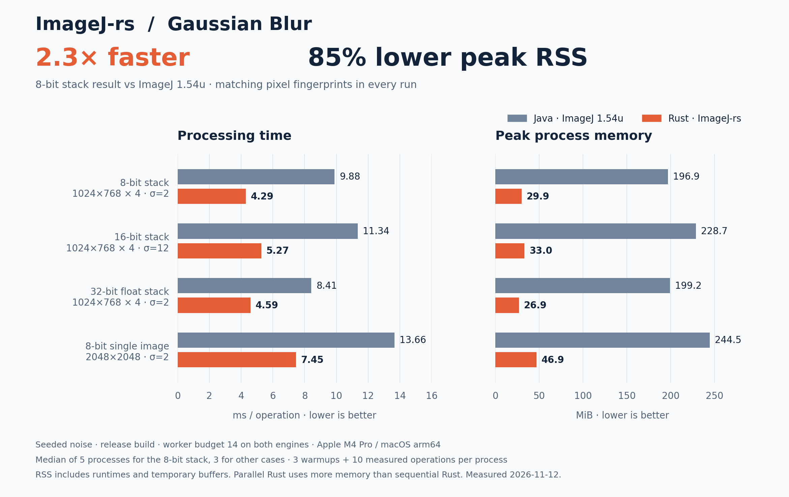

# Gaussian blur benchmark results

Measured on 2026-11-12, using the implementation in commit `eb7c5875fe1cd7d9625a6ba6feccf946632720d4`.



## Results

All cases use identical deterministic inputs in Java and Rust. Every measured run produced matching pixel fingerprints. Times and RSS values are independently calculated medians, so the two medians need not come from the same process.

| Input / dimensions / sigma | Java ms/op | Rust ms/op | Java time ÷ Rust time | Java peak RSS MiB | Rust peak RSS MiB | Processes |
| --- | ---: | ---: | ---: | ---: | ---: | ---: |
| 8-bit noise / 1024×768×4 / 2 | 9.883 | 4.287 | 2.31 | 196.9 | 29.9 | 5 |
| 16-bit noise / 1024×768×4 / 12 | 11.340 | 5.274 | 2.15 | 228.7 | 33.0 | 3 |
| 32-bit noise / 1024×768×4 / 2 | 8.407 | 4.590 | 1.83 | 199.2 | 26.9 | 3 |
| 8-bit noise / 2048×2048×1 / 2 | 13.657 | 7.448 | 1.83 | 244.5 | 46.9 | 3 |
| 8-bit ramp / 1024×768×4 / 2 | 10.775 | 4.639 | 2.32 | 195.8 | 29.9 | 5 |
| 8-bit noise, sequential Rust / 1024×768×4 / 2 | 9.854 | 31.889 | 0.31 | 197.0 | 8.1 | 5 |

The README headline uses the first row: Java time ÷ Rust time is 2.305, and Rust's peak RSS is 84.81% lower. This comparison covers these workloads on one machine. It does not establish a speedup for every ImageJ command or platform.

Parallel Rust uses more peak memory than sequential Rust: 29.9 vs 8.1 MiB in the noise-stack runs. The stack scheduler permits up to four concurrent slices and limits concurrency using a 64 MiB temporary-buffer estimate. An oversized slice still needs its own workspace, so this is not a process memory limit. Column parallelism can require one additional `f32` plane.

## Measurement boundaries

- Host: Apple M4 Pro, macOS 26.3, arm64. Rust 1.99.1 release build; OpenJDK 27.0.1.0.3; unmodified ImageJ 1.54u oracle.
- Each process runs three warmups, then ten timed operations on a fresh image. Java and Rust process order alternates across repetitions.
- Both default worker budgets resolve to 14. Java processes slices sequentially and parallelizes their rows and columns. Rust distributes the budget across slices and their rows and columns. The budget is an upper bound, not a count of active OS threads.
- Worker timers exclude process startup, input generation, warmup, and fingerprinting. The default paths include `IJ.run` or `Session::dispatch` and image processing.
- The sequential Rust row uses `--rust-threads 1`, which calls the core API directly. It omits some Session work, so that timing comparison also includes an entry-point difference.
- `/usr/bin/time` reports peak RSS for the entire process, including the runtime, input generation, warmup, processing, and fingerprinting. RSS is not the processing algorithm's allocation count or Java heap size.
- The stored results were collected before committing the implementation. Their environment records show base commit `b0e24c4` with `git_dirty: true`; `eb7c587` contains that measured implementation.

## Inspect the samples

Each JSON file contains settings, environment versions, aggregate results, individual timings and RSS samples, worker budgets, and pixel fingerprints.

- [8-bit noise stack](data/noise.json)
- [16-bit noise stack](data/gray16.json)
- [32-bit noise stack](data/gray32.json)
- [2048×2048 single image](data/single2048.json)
- [8-bit ramp stack](data/ramp.json)
- [Sequential Rust noise stack](data/noise-sequential.json)

The graph shows the first four workloads. The [benchmark guide](../../../tools/benchmark/README.md) defines the input generators, fingerprint format, and command options.

## Reproduce the measurements and graph

Run from the repository root:

```sh
python3 tools/benchmark/compare.py --cases gaussian --width 1024 --height 768 --slices 4 --iterations 10 --warmup 3 --runs 5 --out-dir verification/benchmarks/reproduce
```

For the other graph rows, add `--type 16 --sigma 12 --runs 3`, `--type 32 --runs 3`, or `--width 2048 --height 2048 --slices 1 --runs 3`. Add `--input ramp` for the ramp row or `--rust-threads 1` for sequential Rust.

To regenerate the PNG and SVG from the checked-in samples, install matplotlib in your Python environment and run:

```sh
python3 docs/benchmarks/gaussian/render.py
```

The renderer reads the stored measurements; it does not run or replace them. [SVG version](gaussian-comparison.svg).
