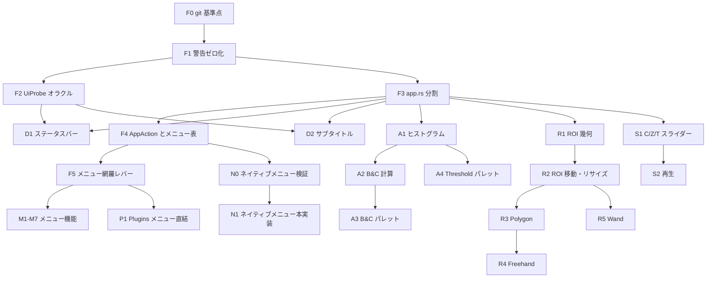

# Phase 2 ロードマップ: UI と使い心地を ImageJ 1.54u に近づける

この文書は Phase 1 監査（2026-11-10）で見つかった不具合とUIギャップを、`deepseek-V4.1-flash` などのサブエージェントが1タスクずつ安全に実装できる単位へ分解したものです。

- 数値・I/O の基盤（Unit 1-6, `docs/architecture_rationale.md`）は完了済みです。
- 本書のタスクは主に `crates/ij-app`（UI）と、それを支える `ij-core` / `ij-session` の小さな追加です。
- タスクは上から順に依存しています。依存先が `VERIFY_ALL_OK` になるまで次へ進まないでください。

---

## 0. 全タスク共通ルール（必ず読む）

### 0.1 作業手順

1. タスク節の「最初に読むもの」を全部読む。Java 側の行番号は `original_imagej/` のものです。
2. 「先に書くテスト」をそのまま書き、`cargo test -p <crate> --test <name>` で**期待どおりの理由で失敗する**ことを確認する。
3. 「編集してよいファイル」だけを変更して実装する。
4. `./tools/verify.sh` を実行し、最終行に `VERIFY_ALL_OK` が出ることを確認する。
5. 末尾の「報告フォーマット」で報告する。

### 0.2 停止条件（ここに当たったら実装を止めて報告する）

- 「編集してよいファイル」以外を変更しないと進めない。
- Java の挙動がソースから一意に読めない。まず `./tools/oracle/run_oracle.sh -eval "<macro>" -batch` で実測し、それでも決まらなければ停止する。
- 同じテスト失敗に対して3回修正しても通らない。失敗ログと仮説を添えて停止する。
- タスクの「非ゴール」に書かれたことが必要になった。

### 0.3 禁止事項

- `original_imagej/` 内のファイルを編集しない。
- `docs/command_ledger.md` と `crates/ij-session/src/generated_commands.rs` を手で編集しない。
- 既存テストを削除しない。`#[ignore]` を付けない。assert を緩めない。
- テストの期待値を「Rust の出力をコピーして」作らない。期待値はオラクル出力か、Java ソースの行番号を引用した手計算から作る。手計算の場合はテスト内コメントに行番号を書く。
- `ij-core` に I/O、UI、egui、サブプロセスのコードを入れない。

### 0.4 UI タスクの検証方法

UI はオラクルで直接比較できないので、次の2層で検証します。

1. **純粋関数の層**: 表示文字列・幾何計算・スライダー換算などは egui 型を使わない純粋関数として切り出し、表形式の単体テストで検証する。可能なものはオラクル（`UiProbe`, タスク F2）と比較する。
2. **ヘッドレス egui の層**: `egui::Context::default()` に `RawInput`（マウス・キーイベント）を流し、`ImageJApp` の公開状態（`session` の ROI、display range、マクロ記録、ステータス文字列）を assert する。既存例は [usability_fidelity_test.rs](file:///Users/nauti/GitHub/ImageJ-rs/crates/ij-app/tests/usability_fidelity_test.rs) と [focus_and_coordinates_test.rs](file:///Users/nauti/GitHub/ImageJ-rs/crates/ij-app/tests/focus_and_coordinates_test.rs) です。

### 0.5 報告フォーマット

```text
TASK: <ID>
STATUS: done | stopped
CHANGED: <ファイル一覧>
NEW TESTS: <テスト名一覧>
VERIFY: <./tools/verify.sh の最終行>
NOTES: <Java 側で判断した点と根拠の行番号、残課題>
```

### 0.6 難易度と担当の目安

| 記号 | 意味 |
| --- | --- |
| 🟢 | flash 単独で可。仕様が閉じていて1-3ファイル。 |
| 🟡 | flash 可だがサブタスク順守が必須。各サブタスク後に verify。 |
| 🔴 | 設計判断・unsafe・大規模移動を含む。上位モデルかレビュー付きで実施。 |

---

## 1. 依存関係と推奨順序



| 順 | タスク | 難易度 | 目的 |
| --- | --- | --- | --- |
| 1 | F0, F1 | 🟢 | 差分管理と警告ゼロ |
| 2 | F2 | 🔴 | UI 文字列をオラクルと比較する手段 |
| 3 | F3 | 🔴 | 4,334行の `app.rs` を flash が扱える大きさに分割 |
| 4 | F4, F5 | 🔴 / 🟢 | メニューを表駆動にし、以降の「1行追加で配線」を可能にする |
| 5 | D1, D2 | 🟢 | 監査で見つけた表示バグの修正 |
| 6 | A1-A4 | 🟡 | B&C と Threshold のライブ化 |
| 7 | R1-R5 | 🟡 | ROI の対話編集とツール追加 |
| 8 | M1-M7 | 🟡 | Duplicate, Crop, Type, Set Measurements, Histogram, Plot Profile, スタック一括 |
| 9 | S1, S2 | 🟡 | ハイパースタック操作 |
| 10 | N0, N1 | 🔴 | macOS 画面上部メニュー |
| 11 | P1 | 🟡 | プラグインをメニューから直接実行 |

---

## 2. 基盤タスク（F）

### F0 git 基準点を作る 🟢

- **ゴール**: リポジトリが git 管理下にあり、各タスクの差分を `git diff` で確認・巻き戻しできる。
- **現状（実測）**: `git log` は exit code 128。リポジトリ未初期化。
- **手順**: `git init`、`.gitignore` に `target/` と `verification/evidence/*`（`latest/` は除外しない）を追加、全ファイルで初回コミット。
- **受け入れ条件**: `git status --short` が空。
- **注意**: ユーザー承認後に実施する。以降のタスクは1タスク1コミット、メッセージは `<ID>: <要約>`。

### F1 コンパイラ警告をゼロにし、警告を verify で検出する 🟢

- **ゴール**: `cargo test --workspace --no-run` の出力に `warning:` が0件。警告が1件でも出たら `./tools/verify.sh` が失敗する。
- **最初に読むもの**: [lib.rs:3780](file:///Users/nauti/GitHub/ImageJ-rs/crates/ij-io/src/lib.rs#L3780)、[verify.sh](file:///Users/nauti/GitHub/ImageJ-rs/tools/verify.sh)
- **編集してよいファイル**: `crates/ij-io/src/lib.rs`, `tools/verify.sh`
- **手順**:
  1. `for (index, palette)` を `for palette in palettes.iter()` に変える（`index` を本当に使わないことを確認）。
  2. `verify.sh` に `cargo test --workspace --no-run 2>&1 | tee "$TMP"` を追加し、`grep -q '^warning' "$TMP"` が真なら `VERIFY_FAIL: compiler warnings` で exit 1。`RUSTFLAGS` は変えない（ビルドキャッシュが毎回無効になるため）。
- **受け入れ条件**: `VERIFY_ALL_OK`。一時的に未使用変数を入れると verify が失敗することを手で確認し、元に戻す。

### F2 UiProbe オラクルを追加する 🔴

- **ゴール**: ImageJ 1.54u の**表示用文字列**（ステータスバー、ウィンドウのサブタイトル、画像サイズ表記）をマクロ1行で取得できる。D1, D2, R1 の期待値はここから取る。
- **背景**: `ImagePlus.getValueAsString` は private、`ImageWindow.createSubtitle` はウィンドウ実体が必要で、通常のマクロからは呼べない。マクロの `call("class.method", "arg"...)` は「String 引数で String を返す static メソッド」を呼べるので、オラクル JAR に static ヘルパーを足す。
- **最初に読むもの**:
  - [OracleRunner.java](file:///Users/nauti/GitHub/ImageJ-rs/tools/oracle/runner/OracleRunner.java)（54行）
  - [build_oracle.sh](file:///Users/nauti/GitHub/ImageJ-rs/tools/oracle/build_oracle.sh) の63行目（ソース一覧に runner を追加している箇所）
  - `tools/oracle/check_manifest.py`, `tools/oracle/check_freshness.py`（runner ソースをハッシュ対象にしているか）
  - [ImagePlus.java:2823-2880](file:///Users/nauti/GitHub/ImageJ-rs/original_imagej/ij/ImagePlus.java#L2823-L2880)
  - [ImageWindow.java:309-396](file:///Users/nauti/GitHub/ImageJ-rs/original_imagej/ij/gui/ImageWindow.java#L309-L396)
- **編集してよいファイル**: `tools/oracle/runner/UiProbe.java`（新規）, `tools/oracle/build_oracle.sh`, `tools/oracle/check_freshness.py`（必要な場合のみ）, `crates/ij-bridge/tests/oracle_ui_probe.rs`（新規）
- **サブタスク**:
  1. `package tools.oracle; public final class UiProbe` を作り、対象画像は `WindowManager.getCurrentImage()` とする。
     - `public static String status(String x, String y)`: `imp.getLocationAsString(x,y)` と、リフレクション（`getDeclaredMethod("getValueAsString", int.class, int.class)` + `setAccessible(true)`）で得た文字列を連結して返す。
     - `public static String subtitle()`: `sun.misc.Unsafe.allocateInstance(ImageWindow.class)` でウィンドウを作らずにインスタンスを得て、protected フィールド `imp` をリフレクションで設定し、`createSubtitle()` を呼ぶ。
     - `public static String imageSize()`: `ImageWindow.getImageSize(imp)`。
  2. `build_oracle.sh` のソース一覧に `UiProbe.java` を追加し、`./tools/oracle/build_oracle.sh` を実行する。
  3. 手で確認する: `./tools/oracle/run_oracle.sh -eval 'newImage("t","8-bit ramp",16,16,1); print(call("tools.oracle.UiProbe.status","3","4")); print(call("tools.oracle.UiProbe.subtitle"));' -batch`
  4. Rust テスト `oracle_ui_probe.rs` を書く。`JavaOracleBridge::run_macro_on_image` で Rust の `ImageDocument::new_ramp_8bit` を渡し、`status` と `subtitle` の stdout が空でなく ` x=3, y=4, value=` で始まることを確認する。
- **受け入れ条件**: 手順3の出力が2行とも出る。`VERIFY_ALL_OK`。
- **非ゴール**: Rust 側の表示ロジック修正（D1, D2 で行う）。
- **フォールバック**: `Unsafe.allocateInstance` が JDK 27 で使えない場合は `subtitle()` を実装せず報告する。D2 は Java ソースからの手計算期待値で進める。

### F3 `app.rs` を機械的に分割する 🔴

- **ゴール**: 振る舞いを一切変えずに、[app.rs](file:///Users/nauti/GitHub/ImageJ-rs/crates/ij-app/src/app.rs)（4,334行）をディレクトリモジュールに分ける。各ファイルを1,000行未満にする。
- **方式**: `src/app.rs` を `src/app/mod.rs` に移し、`app/menu.rs`, `app/image_window.rs`, `app/adjust_dialogs.rs`, `app/plugins_ui.rs`, `app/close_guard.rs`, `app/shortcuts.rs` を子モジュールとして作る。子モジュールは親の private フィールドにアクセスできるので、可視性を変えずに `impl ImageJApp { ... }` ブロックを移すだけで済む。
- **編集してよいファイル**: `crates/ij-app/src/app.rs`（削除）, `crates/ij-app/src/app/*.rs`（新規）
- **サブタスク**（1つ終わるごとに `cargo test -p ij-app` を通す）:
  1. `app.rs` を `app/mod.rs` へ `git mv` するだけ。
  2. `render_menu_bar` と `scrollable_menu` を `menu.rs` へ。
  3. `render_bc_dialog`, `render_threshold_dialog`, Gaussian 等の数値ダイアログを `adjust_dialogs.rs` へ。
  4. 画像ビューポート描画（`render_image_viewport_ui` 周辺）を `image_window.rs` へ。
  5. プラグイン一覧・検査・フィルタ実行 UI を `plugins_ui.rs` へ。
  6. 終了ガードと保存確認を `close_guard.rs` へ、`handle_shortcuts` を `shortcuts.rs` へ。
- **受け入れ条件**: 公開 API（`ij_app::app::*` のパス）が変わらず、既存の `crates/ij-app/tests/*.rs` を1行も変えずに全件通る。`VERIFY_ALL_OK`。
- **禁止**: 関数の中身の書き換え、名前変更、ロジックの「ついで修正」。

### F4 `AppAction` とメニュー表を導入する 🔴

- **ゴール**: メニュー項目・ショートカット・将来のネイティブメニューが、同じ `AppAction` を通って同じ処理と同じ有効判定を使う。新しいメニュー機能は「表に1行 + `perform` に1分岐」で配線できる。
- **型（この形で作る）**:

```rust
// crates/ij-app/src/action.rs
pub enum AppAction { OpenTiff, SaveAs, Close, Measure, Invert, Undo, Smooth, /* 既存のメニュー項目すべて */ }

pub struct MenuNode {
    pub label: &'static str,          // Menus.java の表記そのまま（例 "Duplicate..."）
    pub shortcut: Option<&'static str>,
    pub kind: MenuKind,               // Item(AppAction) | Submenu(&'static [MenuNode]) | Separator | Unsupported
}

pub static MENU_TREE: &[MenuNode] = &[ /* File, Edit, Image, Process, Analyze, Plugins, Window, Help */ ];

impl ImageJApp {
    pub fn action_enabled(&self, a: AppAction) -> Result<(), String>; // Err は無効理由（tooltip に出す）
    pub fn perform(&mut self, a: AppAction, ctx: &egui::Context);
}
```

- **編集してよいファイル**: `crates/ij-app/src/action.rs`（新規）, `crates/ij-app/src/lib.rs`, `crates/ij-app/src/app/menu.rs`, `crates/ij-app/src/app/shortcuts.rs`, `crates/ij-app/tests/action_model_test.rs`（新規）
- **サブタスク**:
  1. `AppAction` と `perform` を作り、既存のメニュー処理本体をそこへ移す。メニュー描画はまだ変えない。
  2. File メニューだけ `MENU_TREE` から描画する。
  3. 残りのメニューを表に移す。`(unsupported)` 項目は `MenuKind::Unsupported` にする。
  4. `handle_shortcuts` の分岐も `perform` を呼ぶようにする。
- **先に書くテスト**: `action_model_test.rs`
  - 画像なしで `action_enabled(Measure)` が `Err`。
  - 8-bit 画像ありで `Ok`、RGB 画像で `Median` が `Err`（現行の 8-bit 限定制約）。
  - `perform(Invert)` 後に画素が反転し、マクロ記録が既存と同じ文字列。
  - `MENU_TREE` のトップレベルラベルが `["File","Edit","Image","Process","Analyze","Plugins","Window","Help"]`。
- **受け入れ条件**: 既存 UI テスト全通過。`VERIFY_ALL_OK`。

### F5 メニュー網羅レバー 🟢

- **ゴール**: 台帳で `RustTier1` に分類されたコマンドのうち、GUI に配線されていないものが一覧化され、配線済みのものが勝手に外れたらテストが落ちる。
- **背景（実測）**: 台帳は `Duplicate...`, `8-bit`, `16-bit`, `32-bit`, `RGB Color`, `Histogram`, `Set Measurements...` を `RustTier1` としているが、`ij-session::Command` にこれらはまだ無い。
- **編集してよいファイル**: `crates/ij-app/tests/menu_coverage_test.rs`（新規）
- **内容**: `COMMAND_SPECS` を走査し、tier が `RustTier1` のラベルが `MENU_TREE` 上で `MenuKind::Item` かを調べる。未配線は `const KNOWN_UNWIRED: &[&str]` に列挙する。
  - 未配線なのに `KNOWN_UNWIRED` に無い → 失敗（退行）。
  - 配線済みなのに `KNOWN_UNWIRED` に残っている → 失敗（リストの掃除漏れ）。
- **受け入れ条件**: `VERIFY_ALL_OK`。以降の M タスクは完了時に `KNOWN_UNWIRED` から1行消す。

---

## 3. 表示バグ修正（D）

### D1 ステータスバーのピクセル値表示 🟢

- **ゴール**: マウス位置のステータス文字列が ImageJ 1.54u の `getLocationAsString + getValueAsString` と一致する。
- **最初に読むもの**: [ImagePlus.java:2823-2880](file:///Users/nauti/GitHub/ImageJ-rs/original_imagej/ij/ImagePlus.java#L2823-L2880)、`IJ.java` 992（`d2s(n)` は小数2桁）、1038（`d2s(x, sig, max)`）、1053（`pad`）、`ij/plugin/Colors.java` 208（`colorToString`）、[app.rs の update_status_for_pixel](file:///Users/nauti/GitHub/ImageJ-rs/crates/ij-app/src/app.rs#L1050-L1065)
- **編集してよいファイル**: `crates/ij-app/src/status_text.rs`（新規）, `crates/ij-app/src/lib.rs`, `update_status_for_pixel` があるファイル, `crates/ij-app/tests/status_text_test.rs`（新規）
- **関数**: `pub fn pixel_status(doc: &ImageDocument, x: i32, y: i32) -> Option<String>`（範囲外は `None`）。
- **仕様（Java の該当行を必ず読んで確認すること）**:
  - 先頭は半角スペース付きの `" x="`。未校正なら ` x=3, y=4`。校正済みなら ` x=1.50 (3), y=2 (4)` のように実寸の後に括弧でピクセル座標。実寸は `n==(int)n` なら整数表記、違えば `IJ.d2s(n)`（2桁）。
  - スタック（stack_size>1）なら `, z=<current_slice-1>` を付ける。ハイパースタックでは `getSlice()-1`（Z 位置）。
  - Gray8 / Gray16: `, value=<v>`。
  - Color256: `, index=<i>, value=<r>,<g>,<b>`（LUT を引いた値）。
  - Gray32: 整数値なら `<d2s(v,0)>.0`、それ以外は `IJ.d2s(v,4,7)`。
  - RGB: `, value=<pad(r,3)>,<pad(g,3)>,<pad(b,3)> (<hex か色名>)`。**注意**: `colorToString` は名前付きの色（例えば純赤）で `#ff0000` ではなく色名を返す。`Colors.getColorName` の表を移植すること。
  - Rust の `Calibration` には値校正関数と原点が無い。`cValue == v` 側だけ実装し、その旨をコメントに書く。
- **配線**: `update_status_for_pixel` を `pixel_status` に置き換える。スライス変更時（矢印・スライダー）にも最後のカーソル位置で再計算する（Java の `updateStatusbarValue` 2798）。
- **先に書くテスト**:
  - 単体: 5形式 × 未校正、Gray8 × 校正（pixel_width=0.5, unit=mm）、3スライススタックの z、Gray32 で 1.0 / 0.5 / 1e-5、RGB で純赤と (18,52,86)。
  - オラクル（F2 依存）: 同じ画像を `UiProbe.status` に通し、文字列完全一致。
- **受け入れ条件**: `VERIFY_ALL_OK`。
- **非ゴール**: FFT 画像の `r=..., theta=` 表記。Alt キーでのタイトル付加。

### D2a ウィンドウのサブタイトル（ラベル以外）🟢

- **ゴール**: [`ImageView::create_subtitle`](file:///Users/nauti/GitHub/ImageJ-rs/crates/ij-app/src/image_view.rs#L70-L104) の出力が `ImageWindow.createSubtitle` と一致する（スライスラベル部分を除く）。
- **現状のずれ（コード読解）**:
  1. 校正済みでも常に `WxH pixels;`。Java は `10.00x10.00 mm (100x100); ` 形式（352-353行）。単位は `Calibration.getUnits()` の複数形。
  2. RGB を 3 byte/pixel で計算している。Java の `getSizeInBytes` は RGB を 4 byte として数える（実装者は `ImagePlus.getSizeInBytes` で確認）。
  3. サイズ表記の閾値が違う。Java は `<1024K` で `K`、`<10000K` で小数1桁 `MB`、`<1048576K` で整数 `MB`、それ以上は `GB`、末尾 `.0` は削る（384-395行）。
  4. inverting LUT のとき ` (inverting LUT)` が付かない（376行）。
- **編集してよいファイル**: `crates/ij-app/src/image_view.rs`, `crates/ij-app/tests/subtitle_test.rs`（新規）
- **仕様**: `Tools.getDecimalPlaces(cwidth, cheight)` を移植し、上限2桁。`IJ.d2s` の丸めモードは `IJ.java` の実装（DecimalFormat の丸め規則）を確認して合わせる。Rust の `f64::round` は half-away-from-zero なので同一とは限らない。
- **先に書くテスト**: 未校正 8/16/32/RGB、校正 mm、3スライススタック、1MB 超（1100×1000 16-bit）、10MB 超、inverting LUT。期待値は `UiProbe.subtitle`（F2）から取る。
- **受け入れ条件**: `VERIFY_ALL_OK`。

### D2b スライスラベルの保持と表示 🟡

- **ゴール**: TIFF の `labl` メタデータで読んだスライスラベルがサブタイトルに `1/3 (label); ` として出る。
- **サブタスク**:
  1. `ij-core::ImageDocument` に `pub slice_labels: Vec<Option<String>>` を追加し、全コンストラクタで `vec![None; n]` に初期化。
  2. `ij-io` の `labl` 読み書きをこのフィールドへ接続する。既存のメタデータ往復テストが通ることを確認。
  3. `ImageStack.getShortSliceLabel` を移植してサブタイトルに反映。単一画像のラベル分岐（328-341行）も実装。
- **受け入れ条件**: ラベル付き3枚スタックを保存→読込→サブタイトルがオラクルと一致。`VERIFY_ALL_OK`。

---

## 4. B&C と Threshold のライブ化（A）

### A1 表示用 256 ビンヒストグラム 🟢

- **ゴール**: `ij-core` に `pub fn display_histogram(doc: &ImageDocument) -> DisplayHistogram { counts: [u64; 256], hmin: f64, hmax: f64 }` があり、8/16/32-bit で ImageJ と一致する。
- **最初に読むもの**: `ContrastAdjuster.java` 628（`plotHistogram`）。16/32-bit で何の範囲を256分割するか、ROI を考慮するかをここで確定する。
- **編集してよいファイル**: `crates/ij-core/src/lib.rs`（または新規 `crates/ij-core/src/histogram.rs`）, `crates/ij-session/tests/oracle_parity.rs`
- **先に書くテスト**: オラクルの `getHistogram(values, counts, 256)` と比較。8-bit ramp、16-bit ramp、32-bit ramp、矩形 ROI あり。
- **受け入れ条件**: `VERIFY_ALL_OK`。

### A2 B&C のスライダー計算 🟢

- **ゴール**: B&C の4本のスライダー（Minimum, Maximum, Brightness, Contrast）の値と display range の相互変換が ImageJ と一致する純粋関数がある。
- **最初に読むもの**: `ContrastAdjuster.java` 432（`setMinAndMax`）、485（`updateScrollBars`）、541（`adjustMin`）、555（`adjustMax`）、579（`adjustBrightness`）、591（`adjustContrast`）、609（`reset`）
- **編集してよいファイル**: `crates/ij-core/src/contrast.rs`（新規）, `crates/ij-core/src/lib.rs`（`mod` 追加のみ）
- **型**: `pub struct ContrastState { default_min, default_max, min, max }` と、各 `adjust_*` 関数、スライダー位置 `fn slider_positions(&ContrastState) -> [i32; 4]`。
- **先に書くテスト**: 各関数に対し、Java の式を行番号付きで手計算した表（8-bit 0..255 と 16-bit 0..4095 の2系統）。
- **受け入れ条件**: `VERIFY_ALL_OK`。
- **非ゴール**: RGB の B&C（チャンネル別適用）。

### A3 B&C パレット UI 🟡

- **ゴール**: スライダーをドラッグしている間、画像表示がフレームごとに更新される。マクロ記録はドラッグ終了時に1行だけ。
- **最初に読むもの**: `ContrastAdjuster.java` 全体の UI 構成と 1264（`ContrastPlot`、128×64）。記録のタイミングは `Recorder.record` 呼び出し箇所を検索して確認。
- **編集してよいファイル**: `crates/ij-session/src/lib.rs`（下記コマンド追加）, `crates/ij-app/src/app/adjust_dialogs.rs`, `crates/ij-app/src/app/bc_palette.rs`（新規）, `crates/ij-app/tests/bc_palette_test.rs`（新規）, `crates/ij-core/src/contrast.rs`, `crates/ij-core/src/lib.rs`（Auto の純粋関数）
- **サブタスク**:
  1. `Command::PreviewDisplayRange { min, max }` を追加する。display range を変えるが、マクロ記録しない。dirty フラグも変えない。既存の `SetDisplayRange` は記録する。
  2. パレットの見た目を作る。上に A1 のヒストグラム（128×64、egui painter で縦棒）、その下に min/max の数値、4本のスライダー、`Auto` / `Reset` / `Set` / `Apply` ボタン。
  3. ドラッグ中は `PreviewDisplayRange`、ドラッグ終了で `SetDisplayRange` を1回。
  4. `Auto`: `ContrastAdjuster` の auto（飽和 0.35%、クリックごとに閾値が変わる）を `ij-core` に移植し、1回目のクリック結果を `run("Enhance Contrast", "saturated=0.35")` 後の `getMinAndMax` と比較するテストを付ける。2回目以降の挙動は Java を読んで実装。
  5. `Apply`（8-bit のみ）: `run("Apply LUT")` とピクセル一致するテストを付ける。16/32-bit は無効表示。
- **先に書くテスト**（ヘッドレス egui）: Maximum スライダーをドラッグ → 毎フレーム `display_range.max` が変わる、テクスチャ revision が増える、マクロ記録はドラッグ終了後に `setMinAndMax(` 1行。
- **受け入れ条件**: `VERIFY_ALL_OK`。旧 `render_bc_dialog` は削除し、`B&C` メニューは新パレットを開く。

### A4 Threshold パレット 🟡

- **ゴール**: 2本のスライダーを動かすと赤オーバーレイがライブに変わる。メソッド選択と Dark background が使える。
- **最初に読むもの**: `ThresholdAdjuster.java` 503（`autoSetLevels`）、563（`scaleUpAndSet`）、592（`updatePlot`）、693 / 716（スライダー）、749（`doSet`）、1040（`ThresholdPlot`）、1214
- **サブタスク**:
  1. 🟢 `scaleUpAndSet` など 16/32-bit のスライダー↔閾値換算を `ij-core` の純粋関数にし、手計算表でテスト。
  2. 🟢 `Command::PreviewThreshold { lower, upper }`（記録しない）を追加。
  3. 🟡 パレット UI。ヒストグラム、Lower / Upper スライダー、メソッド選択（`IsoData` と `Otsu` のみ有効、他は無効表示で理由を tooltip）、`Dark background`、`Auto` / `Reset` / `Set`。表示モードは Red のみ。
- **先に書くテスト**: スライダー操作で `doc.threshold` がフレームごとに変わる。`Auto` + `Otsu` の結果が既存の `AutoThreshold` オラクルテストと同じ値。
- **非ゴール**: `Apply`（二値化）。これは M 系の別タスクで、ボタンは無効表示にする。

---

## 5. ROI の対話編集とツール（R）

### R1 ROI 幾何の純粋モジュール 🟡

- **ゴール**: ハンドル判定・移動・リサイズ・nudge を egui 非依存の関数で計算でき、ImageJ と同じ結果になる。
- **最初に読むもの**: `Roi.java` 950（`moveHandle`）、1191（`nudge`）、1232（`nudgeCorner`）、1287（`handleMouseDrag`）、1404（`getHandleSize`）、1567（`isHandle`）。`ImageCanvas.java` の `mousePressed` で「ROI 内部クリック → 移動」と判定している箇所。
- **編集してよいファイル**: `crates/ij-app/src/roi_edit.rs`（新規）, `crates/ij-app/src/lib.rs`, `crates/ij-app/tests/roi_edit_test.rs`（新規）。必要なら `tools/oracle/runner/UiProbe.java` に `nudge(key)` / `nudgeCorner(key)` を追加してよい。
- **API**:

```rust
pub enum RoiHit { Handle(u8), Inside, Outside }
pub fn hit_test(roi: &Roi, screen: (f64, f64), mag: f64, src_origin: (f64, f64)) -> RoiHit;
pub fn move_by(roi: &Roi, dx: i32, dy: i32) -> Roi;
pub fn drag_handle(roi: &Roi, handle: u8, image_xy: (i32, i32)) -> Roi;
pub enum Arrow { Left, Right, Up, Down }
pub fn nudge(roi: &Roi, a: Arrow, img_w: u32, img_h: u32) -> Roi;
pub fn nudge_corner(roi: &Roi, a: Arrow, img_w: u32, img_h: u32) -> Roi;
```

- **対象**: 矩形と楕円（8ハンドル）、線分（端点2つ + 中央）。多角形の頂点ハンドルは R3。
- **先に書くテスト**: ハンドル番号の並び（Java の番号付けに合わせる）、拡大率 1/2/4 でのヒット判定、画像端での nudge の振る舞い。可能なら `UiProbe.nudge` 後の `getSelectionBounds` と比較。
- **受け入れ条件**: `VERIFY_ALL_OK`。

### R2 ROI の移動・リサイズ・矢印キーを画像ウィンドウに配線 🟡

- **ゴール**: 既存 ROI の内部をドラッグすると移動、ハンドルをドラッグするとリサイズ、外側をドラッグすると新規作成になる。矢印キーが ImageJ と同じ規則で動く。
- **最初に読むもの**: [ImageJ.java:532-560](file:///Users/nauti/GitHub/ImageJ-rs/original_imagej/ij/ImageJ.java#L532-L560)
- **矢印キー規則（Java 543-559 の要約、必ず原文で確認）**:
  - `stackKey = stack_size>1 && (roi==None || shift)`。`stackKey` で Right なら次スライス、Left なら前スライス。
  - それ以外で ROI があれば、Alt か Ctrl 付きで `nudgeCorner`、無ければ `nudge`。
  - **現状との差**: 今の Rust は ROI があっても左右矢印でスライスが変わる。
- **編集してよいファイル**: `crates/ij-app/src/app/image_window.rs`, `crates/ij-app/src/app/shortcuts.rs`, `crates/ij-app/tests/roi_interaction_test.rs`（新規）
- **先に書くテスト**（ヘッドレス egui）: 内部ドラッグで ROI の x,y が `dx/mag` 動く。右下ハンドルで幅高さが変わる。外側ドラッグで新規 ROI。スタック + ROI で Right は nudge、Shift+Right は次スライス。ROI 無しスタックで Right は次スライス。移動完了時のマクロ記録が `makeRectangle(...)` 1行。
- **受け入れ条件**: `VERIFY_ALL_OK`。カーソル形状（移動・リサイズ）も変える。

### R3 Polygon ツール 🟡

- **ゴール**: Polygon ツールでクリックごとに頂点が増え、ダブルクリックまたは始点付近クリックで閉じて `Command::MakePolygonRoi` が出る。
- **最初に読むもの**: `PolygonRoi.java` の構築中のマウス処理（`handleMouseUp`, `addPoint`, 閉じる判定）。
- **編集してよいファイル**: `crates/ij-app/src/tool.rs`（Polygon を有効化）, `crates/ij-app/src/app/image_window.rs`, `crates/ij-app/tests/polygon_tool_test.rs`（新規）, `crates/ij-app/tests/ui_model_test.rs`, `crates/ij-app/tests/desktop_ui_test.rs`（Polygon の旧「未対応」期待値を更新）
- **先に書くテスト**: クリック4回 + ダブルクリック → session の ROI が4頂点の多角形。その ROI で `Measure` した Area がオラクルの `makePolygon(...)` と一致（既存パリティ基盤を流用）。構築中は始点からのラバーバンドを描く。
- **受け入れ条件**: `VERIFY_ALL_OK`。

### R4 Freehand ツール 🟢

- **ゴール**: ドラッグ軌跡が整数座標の多角形 ROI になり、計測がオラクルの `makeSelection("freehand", xs, ys)` と一致する。
- **注意**: 1.54u の freehand がサブピクセル座標を使うかを `Prefs.subPixelResolution` と `PolygonRoi` で確認すること。連続重複点は除く。
- **編集してよいファイル**: `tool.rs`, `app/image_window.rs`, `crates/ij-app/tests/freehand_tool_test.rs`（新規）, `crates/ij-app/tests/desktop_ui_test.rs`（Freehand の旧「未対応」期待値を更新）

### R5 Wand ツール 🟡

- **サブタスク**:
  1. 🟡 `ij-core` に `Wand::auto_outline(doc, x, y, tolerance, mode)` を移植（`ij/gui/Wand.java`、legacy モードと tolerance=0 から）。オラクルの `doWand(x,y); getSelectionCoordinates(xs,ys);` と頂点列が完全一致するテストを先に書く。閾値設定済み画像のケースも1つ入れる。
  2. 🟢 ツールバーの Wand を有効化し、クリックで 1 の結果を `MakePolygonRoi` として出す。
- **非ゴール**: Wand Tool Options ダイアログ。

### R6 以降（今回は対象外）

Point, Angle, Text, Dropper は `ij-core` に新しい ROI 型と計測規則が要るため、Phase 3 で個別に設計する。

---

## 6. メニュー機能の追加（M）

各タスクの共通形は「`ij-core` 純粋関数 → `ij-session::Command` → オラクルパリティテスト → `AppAction` と `MENU_TREE` に1行 → `KNOWN_UNWIRED` から1行削除」です。

| ID | 機能 | 最初に読むもの | 先に書くオラクルテスト | 難易度 |
| --- | --- | --- | --- | --- |
| M1 | Crop | `ij/plugin/Resizer.java`（`crop`） | 矩形 ROI で `run("Crop")` → 画素・寸法・校正一致。5形式とスタック。 | 🟢 |
| M2 | Duplicate... | `Duplicator.java` 230（`run`）, 295（`crop`） | `run("Duplicate...", "title=x")` と ROI あり、スタック範囲 `range=2-3`。新しいウィンドウのタイトル規則（`-1` 付加）。 | 🟡 |
| M3a | Type > 8-bit | `ImageConverter.java` 24, `TypeConverter.java` | 16/32-bit から display range でスケーリング。`Conversions` の scale=true 既定。 | 🟢 |
| M3b | Type > 16-bit | `ImageConverter.java` 58 | 8/32-bit から。 | 🟢 |
| M3c | Type > 32-bit | `ImageConverter.java` 171 | 8/16-bit から。校正値の扱い。 | 🟢 |
| M3d | Type > RGB Color | `ImageConverter.java` 192 | 8-bit + LUT から。 | 🟢 |
| M4a | 計測項目フラグ | `ij/plugin/filter/Analyzer.java`, `ij/measure/Measurements.java` | `run("Set Measurements...", "area mean min ...")` 後の Results 列見出しと値。 | 🟡 |
| M4b | Results 列順と小数桁 | `ij/measure/ResultsTable.java` | `saveAs("Results", path)` の CSV と Rust 出力の一致。 | 🟡 |
| M4c | Set Measurements ダイアログ | `Analyzer.java` のダイアログ構成 | ヘッドレス egui でチェック → 次の Measure の列が変わる。 | 🟢 |
| M5 | Histogram ウィンドウ | `ij/gui/HistogramWindow.java`, `HistogramPlot.java` | 統計値（N, Mean, StdDev, Min, Max, Mode）とビン値。A1 を流用。 | 🟡 |
| M6a | Plot Profile の値 | `ij/gui/ProfilePlot.java` | 線 ROI と矩形 ROI で `getProfile()` の配列一致。 | 🟡 |
| M6b | Plot Profile ウィンドウ | `ij/gui/PlotWindow.java` | M6a の値で折れ線を描く。List ボタンで値表。 | 🟢 |
| M7 | スタック一括フィルタ | [stack_process.rs:58-72](file:///Users/nauti/GitHub/ImageJ-rs/crates/ij-app/src/stack_process.rs#L58-L72) | `run("Gaussian Blur...", "sigma=2 stack")` などを各フィルタで。完了後 `supports_whole_stack` を全対応に。Undo の扱いは Java で確認。 | 🟡 |

- M2 は「タイトル規則」と「スタック範囲」でつまずきやすい。サブタスクを (1) 単一画像全体、(2) ROI、(3) スタック範囲、(4) ダイアログ の順に分ける。
- M4 は `MeasurementSummary` と `ResultsTable` の両方に触る。M4a で列の定義表（`Measurements.java` のフラグ → 列名）を先に作り、それ以外は変えない。

---

## 7. スタック操作（S）

### S1 C/Z/T スライダー 🟡

- **ゴール**: ハイパースタックで、チャンネル・Z・時間の各次元が1より大きいものについて `c` / `z` / `t` のスライダーが表示され、`Command::SetPosition` を通じて位置が変わる。
- **最初に読むもの**: `ij/gui/StackWindow.java`（スクロールバーの表示条件と順序）、[ij-core の set_position](file:///Users/nauti/GitHub/ImageJ-rs/crates/ij-core/src/lib.rs#L918)
- **編集してよいファイル**: `app/image_window.rs`, `crates/ij-app/tests/hyperstack_ui_test.rs`（新規）
- **先に書くテスト**: 2c×3z×4t の文書で3本表示、1c×5z×1t では1本。`t` を動かすと `get_position()` の3要素目だけ変わる。サブタイトルが `c:1/2 z:2/3 t:3/4` 相当の表記になる（Java で確認）。

### S2 再生ボタン 🟡

- **ゴール**: 再生ボタンで Z（またはT）が一定間隔で進み、もう一度押すと止まる。
- **最初に読むもの**: `ij/plugin/Animator.java`（既定 fps と、ハイパースタックでどの次元を回すか）
- **テスト方法**: 時刻を引数で注入できる `fn advance_animation(&mut self, now: f64)` を作り、壁時計を使わずに「1/fps 秒ごとに1枚進む」を検証する。描画側は `ctx.request_repaint_after` を使う。

---

## 8. macOS ネイティブメニュー（N）

### N0 検証スパイク 🔴（時間枠: 半日）

- **問い**: eframe 0.31（winit 0.30）に `muda` クレートで画面上部の NSMenu を載せ、クリックを `update()` 内で受け取れるか。既存の [macos_bridge.rs](file:///Users/nauti/GitHub/ImageJ-rs/crates/ij-app/src/macos_bridge.rs) の `applicationShouldTerminate:` フックと衝突しないか。
- **編集してよいファイル**: `crates/ij-app/examples/native_menu_spike.rs`（新規）, `crates/ij-app/Cargo.toml`（`[target.'cfg(target_os = "macos")'.dev-dependencies]` に muda）
- **Go 条件（全部満たすこと）**:
  1. 画面上部に `ImageJ-rs | File | Edit | ...` が出る。
  2. `File > Open...` のクリックがアプリ側のチャネルで受信できる。
  3. 有効・無効をフレームごとに切り替えても描画が乱れない。
  4. Cmd+Q で既存の未保存確認が出る。
- **No-Go の場合のフォールバック**: egui メニューを維持し、メニューのポップアップを別 viewport（`ctx.show_viewport_immediate`）で開いて 200px の高さ制限を外す。
- **報告**: Go / No-Go と、その根拠になった実測結果。

### N1 本実装（N0 が Go のとき）🟡

- **ゴール**: `MENU_TREE`（F4）から NSMenu を生成し、選択は `perform(AppAction)` に流れ、`action_enabled` が有効表示に反映される。macOS ではルートウィンドウ内の egui メニューを出さない。
- **ショートカット**: NSMenu 側は Cmd 付きのみ登録する。`M`, `Z` などの単キーは従来どおり `shortcuts.rs` で処理する（ImageJ も macOS では同じ分担）。
- **先に書くテスト**: `MENU_TREE` → 中間表現（ラベル・有効・ショートカットの木）への変換を純粋関数にし、その出力をテストする。NSMenu 生成自体は手動確認でよい。

---

## 9. プラグイン（P）

### P1 Plugins メニューからの直接実行 🟡

- **ゴール**: 起動時（または前回スキャン結果のキャッシュ）から互換プラグインが `Plugins` メニュー直下に並び、クリック1回で実行できる。非互換のものは無効表示で理由を tooltip に出す。
- **サブタスク**:
  1. 🟢 スキャン結果を JSON でアプリデータディレクトリにキャッシュし、起動時に読む。破損時は無視して空扱い。
  2. 🟢 `MENU_TREE` の Plugins 部分を動的に生成する仕組み（`MenuKind::Dynamic`）。
  3. 🟡 クリック → 既存の `prefill_plugin_filter_from_catalog` → 実行、を1操作にまとめる。既存のチケット（`PluginFilterTicket`）とキャンセル経路はそのまま使う。
- **非ゴール**: `GenericDialog` を出すプラグイン、16-bit やスタック対応。これらは子 JVM 側で AWT ダイアログを扱う設計が必要なので Phase 3 で扱う。

---

## 10. 完了の定義（Phase 2 全体）

- F5 の `KNOWN_UNWIRED` から M1-M7 の項目が消えている。
- 監査で挙げた6つのUIギャップのうち、メニュー位置（N）、ROI 編集（R1-R3）、B&C / Threshold（A3, A4）、C/Z/T（S1）、主要メニュー（M）が解消している。
- `./tools/verify.sh` が `VERIFY_ALL_OK`、警告0件。
