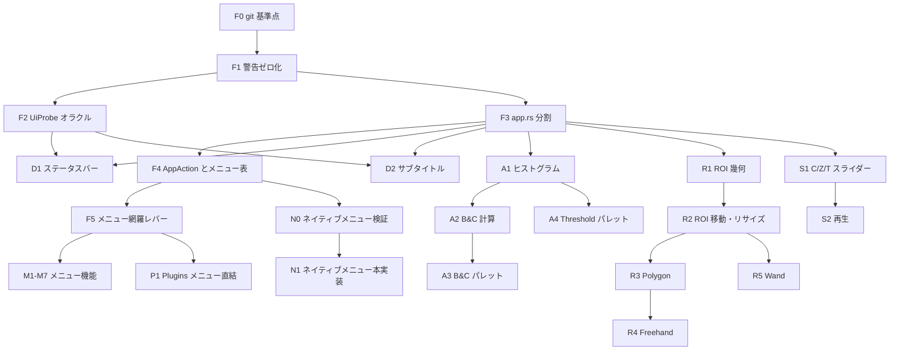

# Phase 2 ロードマップ: UI と使い心地を ImageJ 1.54u に近づける

この文書は Phase 1 監査（2026-11-10）で見つかった不具合とUIギャップを、`deepseek-V4.1-flash` などのサブエージェントが1タスクずつ安全に実装できる単位へ分解したものです。

- 数値・I/O の基盤（Unit 1-6, `docs/architecture_rationale.md`）は完了済みです。
- 本書のタスクは主に `crates/ij-app`（UI）と、それを支える `ij-core` / `ij-session` の小さな追加です。
- タスクは上から順に依存しています。依存先が `VERIFY_ALL_OK` になるまで次へ進まないでください。

---

## 0. 全タスク共通ルール（必ず読む）

### 0.1 作業手順

1. タスク節の「最初に読むもの」を全部読む。Java 側の行番号は `original_imagej/` のものです。
2. 「先に書くテスト」をそのまま書き、`cargo test -p <crate> --test <name>` で**期待どおりの理由で失敗する**ことを確認する。
3. 「編集してよいファイル」だけを変更して実装する。
4. `./tools/verify.sh` を実行し、最終行に `VERIFY_ALL_OK` が出ることを確認する。
5. 末尾の「報告フォーマット」で報告する。

### 0.2 停止条件（ここに当たったら実装を止めて報告する）

- 「編集してよいファイル」以外を変更しないと進めない。
- Java の挙動がソースから一意に読めない。まず `./tools/oracle/run_oracle.sh -eval "<macro>" -batch` で実測し、それでも決まらなければ停止する。
- 同じテスト失敗に対して3回修正しても通らない。失敗ログと仮説を添えて停止する。
- タスクの「非ゴール」に書かれたことが必要になった。

### 0.3 禁止事項

- `original_imagej/` 内のファイルを編集しない。
- `docs/command_ledger.md` と `crates/ij-session/src/generated_commands.rs` を手で編集しない。
- 既存テストを削除しない。`#[ignore]` を付けない。assert を緩めない。
- テストの期待値を「Rust の出力をコピーして」作らない。期待値はオラクル出力か、Java ソースの行番号を引用した手計算から作る。手計算の場合はテスト内コメントに行番号を書く。
- `ij-core` に I/O、UI、egui、サブプロセスのコードを入れない。

### 0.4 UI タスクの検証方法

UI はオラクルで直接比較できないので、次の2層で検証します。

1. **純粋関数の層**: 表示文字列・幾何計算・スライダー換算などは egui 型を使わない純粋関数として切り出し、表形式の単体テストで検証する。可能なものはオラクル（`UiProbe`, タスク F2）と比較する。
2. **ヘッドレス egui の層**: `egui::Context::default()` に `RawInput`（マウス・キーイベント）を流し、`ImageJApp` の公開状態（`session` の ROI、display range、マクロ記録、ステータス文字列）を assert する。既存例は [usability_fidelity_test.rs](file:///Users/nauti/GitHub/ImageJ-rs/crates/ij-app/tests/usability_fidelity_test.rs) と [focus_and_coordinates_test.rs](file:///Users/nauti/GitHub/ImageJ-rs/crates/ij-app/tests/focus_and_coordinates_test.rs) です。

### 0.5 報告フォーマット

```text
TASK: <ID>
STATUS: done | stopped
CHANGED: <ファイル一覧>
NEW TESTS: <テスト名一覧>
VERIFY: <./tools/verify.sh の最終行>
NOTES: <Java 側で判断した点と根拠の行番号、残課題>
```

### 0.6 難易度と担当の目安

| 記号 | 意味 |
| --- | --- |
| 🟢 | flash 単独で可。仕様が閉じていて1-3ファイル。 |
| 🟡 | flash 可だがサブタスク順守が必須。各サブタスク後に verify。 |
| 🔴 | 設計判断・unsafe・大規模移動を含む。上位モデルかレビュー付きで実施。 |

---

## 1. 依存関係と推奨順序



| 順 | タスク | 難易度 | 目的 |
| --- | --- | --- | --- |
| 1 | F0, F1 | 🟢 | 差分管理と警告ゼロ |
| 2 | F2 | 🔴 | UI 文字列をオラクルと比較する手段 |
| 3 | F3 | 🔴 | 4,334行の `app.rs` を flash が扱える大きさに分割 |
| 4 | F4, F5 | 🔴 / 🟢 | メニューを表駆動にし、以降の「1行追加で配線」を可能にする |
| 5 | D1, D2 | 🟢 | 監査で見つけた表示バグの修正 |
| 6 | A1-A4 | 🟡 | B&C と Threshold のライブ化 |
| 7 | R1-R5 | 🟡 | ROI の対話編集とツール追加 |
| 8 | M1-M7 | 🟡 | Duplicate, Crop, Type, Set Measurements, Histogram, Plot Profile, スタック一括 |
| 9 | S1, S2 | 🟡 | ハイパースタック操作 |
| 10 | N0, N1 | 🔴 | macOS 画面上部メニュー |
| 11 | P1 | 🟡 | プラグインをメニューから直接実行 |

---

## 2. 基盤タスク（F）

### F0 git 基準点を作る 🟢

- **ゴール**: リポジトリが git 管理下にあり、各タスクの差分を `git diff` で確認・巻き戻しできる。
- **現状（実測）**: `git log` は exit code 128。リポジトリ未初期化。
- **手順**: `git init`、`.gitignore` に `target/` と `verification/evidence/*`（`latest/` は除外しない）を追加、全ファイルで初回コミット。
- **受け入れ条件**: `git status --short` が空。
- **注意**: ユーザー承認後に実施する。以降のタスクは1タスク1コミット、メッセージは `<ID>: <要約>`。

### F1 コンパイラ警告をゼロにし、警告を verify で検出する 🟢

- **ゴール**: `cargo test --workspace --no-run` の出力に `warning:` が0件。警告が1件でも出たら `./tools/verify.sh` が失敗する。
- **最初に読むもの**: [lib.rs:3780](file:///Users/nauti/GitHub/ImageJ-rs/crates/ij-io/src/lib.rs#L3780)、[verify.sh](file:///Users/nauti/GitHub/ImageJ-rs/tools/verify.sh)
- **編集してよいファイル**: `crates/ij-io/src/lib.rs`, `tools/verify.sh`
- **手順**:
  1. `for (index, palette)` を `for palette in palettes.iter()` に変える（`index` を本当に使わないことを確認）。
  2. `verify.sh` に `cargo test --workspace --no-run 2>&1 | tee "$TMP"` を追加し、`grep -q '^warning' "$TMP"` が真なら `VERIFY_FAIL: compiler warnings` で exit 1。`RUSTFLAGS` は変えない（ビルドキャッシュが毎回無効になるため）。
- **受け入れ条件**: `VERIFY_ALL_OK`。一時的に未使用変数を入れると verify が失敗することを手で確認し、元に戻す。

### F2 UiProbe オラクルを追加する 🔴

- **ゴール**: ImageJ 1.54u の**表示用文字列**（ステータスバー、ウィンドウのサブタイトル、画像サイズ表記）をマクロ1行で取得できる。D1, D2, R1 の期待値はここから取る。
- **背景**: `ImagePlus.getValueAsString` は private、`ImageWindow.createSubtitle` はウィンドウ実体が必要で、通常のマクロからは呼べない。マクロの `call("class.method", "arg"...)` は「String 引数で String を返す static メソッド」を呼べるので、オラクル JAR に static ヘルパーを足す。
- **最初に読むもの**:
  - [OracleRunner.java](file:///Users/nauti/GitHub/ImageJ-rs/tools/oracle/runner/OracleRunner.java)（54行）
  - [build_oracle.sh](file:///Users/nauti/GitHub/ImageJ-rs/tools/oracle/build_oracle.sh) の63行目（ソース一覧に runner を追加している箇所）
  - `tools/oracle/check_manifest.py`, `tools/oracle/check_freshness.py`（runner ソースをハッシュ対象にしているか）
  - [ImagePlus.java:2823-2880](file:///Users/nauti/GitHub/ImageJ-rs/original_imagej/ij/ImagePlus.java#L2823-L2880)
  - [ImageWindow.java:309-396](file:///Users/nauti/GitHub/ImageJ-rs/original_imagej/ij/gui/ImageWindow.java#L309-L396)
- **編集してよいファイル**: `tools/oracle/runner/UiProbe.java`（新規）, `tools/oracle/build_oracle.sh`, `tools/oracle/check_freshness.py`（必要な場合のみ）, `crates/ij-bridge/tests/oracle_ui_probe.rs`（新規）
- **サブタスク**:
  1. `package tools.oracle; public final class UiProbe` を作り、対象画像は `WindowManager.getCurrentImage()` とする。
     - `public static String status(String x, String y)`: `imp.getLocationAsString(x,y)` と、リフレクション（`getDeclaredMethod("getValueAsString", int.class, int.class)` + `setAccessible(true)`）で得た文字列を連結して返す。
     - `public static String subtitle()`: `sun.misc.Unsafe.allocateInstance(ImageWindow.class)` でウィンドウを作らずにインスタンスを得て、protected フィールド `imp` をリフレクションで設定し、`createSubtitle()` を呼ぶ。
     - `public static String imageSize()`: `ImageWindow.getImageSize(imp)`。
  2. `build_oracle.sh` のソース一覧に `UiProbe.java` を追加し、`./tools/oracle/build_oracle.sh` を実行する。
  3. 手で確認する: `./tools/oracle/run_oracle.sh -eval 'newImage("t","8-bit ramp",16,16,1); print(call("tools.oracle.UiProbe.status","3","4")); print(call("tools.oracle.UiProbe.subtitle"));' -batch`
  4. Rust テスト `oracle_ui_probe.rs` を書く。`JavaOracleBridge::run_macro_on_image` で Rust の `ImageDocument::new_ramp_8bit` を渡し、`status` と `subtitle` の stdout が空でなく ` x=3, y=4, value=` で始まることを確認する。
- **受け入れ条件**: 手順3の出力が2行とも出る。`VERIFY_ALL_OK`。
- **非ゴール**: Rust 側の表示ロジック修正（D1, D2 で行う）。
- **フォールバック**: `Unsafe.allocateInstance` が JDK 27 で使えない場合は `subtitle()` を実装せず報告する。D2 は Java ソースからの手計算期待値で進める。

### F3 `app.rs` を機械的に分割する 🔴

- **ゴール**: 振る舞いを一切変えずに、[app.rs](file:///Users/nauti/GitHub/ImageJ-rs/crates/ij-app/src/app.rs)（4,334行）をディレクトリモジュールに分ける。各ファイルを1,000行未満にする。
- **方式**: `src/app.rs` を `src/app/mod.rs` に移し、`app/menu.rs`, `app/image_window.rs`, `app/adjust_dialogs.rs`, `app/plugins_ui.rs`, `app/close_guard.rs`, `app/shortcuts.rs` を子モジュールとして作る。子モジュールは親の private フィールドにアクセスできるので、可視性を変えずに `impl ImageJApp { ... }` ブロックを移すだけで済む。
- **編集してよいファイル**: `crates/ij-app/src/app.rs`（削除）, `crates/ij-app/src/app/*.rs`（新規）
- **サブタスク**（1つ終わるごとに `cargo test -p ij-app` を通す）:
  1. `app.rs` を `app/mod.rs` へ `git mv` するだけ。
  2. `render_menu_bar` と `scrollable_menu` を `menu.rs` へ。
  3. `render_bc_dialog`, `render_threshold_dialog`, Gaussian 等の数値ダイアログを `adjust_dialogs.rs` へ。
  4. 画像ビューポート描画（`render_image_viewport_ui` 周辺）を `image_window.rs` へ。
  5. プラグイン一覧・検査・フィルタ実行 UI を `plugins_ui.rs` へ。
  6. 終了ガードと保存確認を `close_guard.rs` へ、`handle_shortcuts` を `shortcuts.rs` へ。
- **受け入れ条件**: 公開 API（`ij_app::app::*` のパス）が変わらず、既存の `crates/ij-app/tests/*.rs` を1行も変えずに全件通る。`VERIFY_ALL_OK`。
- **禁止**: 関数の中身の書き換え、名前変更、ロジックの「ついで修正」。

### F4 `AppAction` とメニュー表を導入する 🔴

- **ゴール**: メニュー項目・ショートカット・将来のネイティブメニューが、同じ `AppAction` を通って同じ処理と同じ有効判定を使う。新しいメニュー機能は「表に1行 + `perform` に1分岐」で配線できる。
- **型（この形で作る）**:

```rust
// crates/ij-app/src/action.rs
pub enum AppAction { OpenTiff, SaveAs, Close, Measure, Invert, Undo, Smooth, /* 既存のメニュー項目すべて */ }

pub struct MenuNode {
    pub label: &'static str,          // Menus.java の表記そのまま（例 "Duplicate..."）
    pub shortcut: Option<&'static str>,
    pub kind: MenuKind,               // Item(AppAction) | Submenu(&'static [MenuNode]) | Separator | Unsupported
}

pub static MENU_TREE: &[MenuNode] = &[ /* File, Edit, Image, Process, Analyze, Plugins, Window, Help */ ];

impl ImageJApp {
    pub fn action_enabled(&self, a: AppAction) -> Result<(), String>; // Err は無効理由（tooltip に出す）
    pub fn perform(&mut self, a: AppAction, ctx: &egui::Context);
}
```

- **編集してよいファイル**: `crates/ij-app/src/action.rs`（新規）, `crates/ij-app/src/lib.rs`, `crates/ij-app/src/app/menu.rs`, `crates/ij-app/src/app/shortcuts.rs`, `crates/ij-app/tests/action_model_test.rs`（新規）
- **サブタスク**:
  1. `AppAction` と `perform` を作り、既存のメニュー処理本体をそこへ移す。メニュー描画はまだ変えない。
  2. File メニューだけ `MENU_TREE` から描画する。
  3. 残りのメニューを表に移す。`(unsupported)` 項目は `MenuKind::Unsupported` にする。
  4. `handle_shortcuts` の分岐も `perform` を呼ぶようにする。
- **先に書くテスト**: `action_model_test.rs`
  - 画像なしで `action_enabled(Measure)` が `Err`。
  - 8-bit 画像ありで `Ok`、RGB 画像で `Median` が `Err`（現行の 8-bit 限定制約）。
  - `perform(Invert)` 後に画素が反転し、マクロ記録が既存と同じ文字列。
  - `MENU_TREE` のトップレベルラベルが `["File","Edit","Image","Process","Analyze","Plugins","Window","Help"]`。
- **受け入れ条件**: 既存 UI テスト全通過。`VERIFY_ALL_OK`。

### F5 メニュー網羅レバー 🟢

- **ゴール**: 台帳で `RustTier1` に分類されたコマンドのうち、GUI に配線されていないものが一覧化され、配線済みのものが勝手に外れたらテストが落ちる。
- **背景（実測）**: 台帳は `Duplicate...`, `8-bit`, `16-bit`, `32-bit`, `RGB Color`, `Histogram`, `Set Measurements...` を `RustTier1` としているが、`ij-session::Command` にこれらはまだ無い。
- **編集してよいファイル**: `crates/ij-app/tests/menu_coverage_test.rs`（新規）
- **内容**: `COMMAND_SPECS` を走査し、tier が `RustTier1` のラベルが `MENU_TREE` 上で `MenuKind::Item` かを調べる。未配線は `const KNOWN_UNWIRED: &[&str]` に列挙する。
  - 未配線なのに `KNOWN_UNWIRED` に無い → 失敗（退行）。
  - 配線済みなのに `KNOWN_UNWIRED` に残っている → 失敗（リストの掃除漏れ）。
- **受け入れ条件**: `VERIFY_ALL_OK`。以降の M タスクは完了時に `KNOWN_UNWIRED` から1行消す。

---

## 3. 表示バグ修正（D）

### D1 ステータスバーのピクセル値表示 🟢

- **ゴール**: マウス位置のステータス文字列が ImageJ 1.54u の `getLocationAsString + getValueAsString` と一致する。
- **最初に読むもの**: [ImagePlus.java:2823-2880](file:///Users/nauti/GitHub/ImageJ-rs/original_imagej/ij/ImagePlus.java#L2823-L2880)、`IJ.java` 992（`d2s(n)` は小数2桁）、1038（`d2s(x, sig, max)`）、1053（`pad`）、`ij/plugin/Colors.java` 208（`colorToString`）、[app.rs の update_status_for_pixel](file:///Users/nauti/GitHub/ImageJ-rs/crates/ij-app/src/app.rs#L1050-L1065)
- **編集してよいファイル**: `crates/ij-app/src/status_text.rs`（新規）, `crates/ij-app/src/lib.rs`, `update_status_for_pixel` があるファイル, `crates/ij-app/tests/status_text_test.rs`（新規）
- **関数**: `pub fn pixel_status(doc: &ImageDocument, x: i32, y: i32) -> Option<String>`（範囲外は `None`）。
- **仕様（Java の該当行を必ず読んで確認すること）**:
  - 先頭は半角スペース付きの `" x="`。未校正なら ` x=3, y=4`。校正済みなら ` x=1.50 (3), y=2 (4)` のように実寸の後に括弧でピクセル座標。実寸は `n==(int)n` なら整数表記、違えば `IJ.d2s(n)`（2桁）。
  - スタック（stack_size>1）なら `, z=<current_slice-1>` を付ける。ハイパースタックでは `getSlice()-1`（Z 位置）。
  - Gray8 / Gray16: `, value=<v>`。
  - Color256: `, index=<i>, value=<r>,<g>,<b>`（LUT を引いた値）。
  - Gray32: 整数値なら `<d2s(v,0)>.0`、それ以外は `IJ.d2s(v,4,7)`。
  - RGB: `, value=<pad(r,3)>,<pad(g,3)>,<pad(b,3)> (<hex か色名>)`。**注意**: `colorToString` は名前付きの色（例えば純赤）で `#ff0000` ではなく色名を返す。`Colors.getColorName` の表を移植すること。
  - Rust の `Calibration` には値校正関数と原点が無い。`cValue == v` 側だけ実装し、その旨をコメントに書く。
- **配線**: `update_status_for_pixel` を `pixel_status` に置き換える。スライス変更時（矢印・スライダー）にも最後のカーソル位置で再計算する（Java の `updateStatusbarValue` 2798）。
- **先に書くテスト**:
  - 単体: 5形式 × 未校正、Gray8 × 校正（pixel_width=0.5, unit=mm）、3スライススタックの z、Gray32 で 1.0 / 0.5 / 1e-5、RGB で純赤と (18,52,86)。
  - オラクル（F2 依存）: 同じ画像を `UiProbe.status` に通し、文字列完全一致。
- **受け入れ条件**: `VERIFY_ALL_OK`。
- **非ゴール**: FFT 画像の `r=..., theta=` 表記。Alt キーでのタイトル付加。

### D2a ウィンドウのサブタイトル（ラベル以外）🟢

- **ゴール**: [`ImageView::create_subtitle`](file:///Users/nauti/GitHub/ImageJ-rs/crates/ij-app/src/image_view.rs#L70-L104) の出力が `ImageWindow.createSubtitle` と一致する（スライスラベル部分を除く）。
- **現状のずれ（コード読解）**:
  1. 校正済みでも常に `WxH pixels;`。Java は `10.00x10.00 mm (100x100); ` 形式（352-353行）。単位は `Calibration.getUnits()` の複数形。
  2. RGB を 3 byte/pixel で計算している。Java の `getSizeInBytes` は RGB を 4 byte として数える（実装者は `ImagePlus.getSizeInBytes` で確認）。
  3. サイズ表記の閾値が違う。Java は `<1024K` で `K`、`<10000K` で小数1桁 `MB`、`<1048576K` で整数 `MB`、それ以上は `GB`、末尾 `.0` は削る（384-395行）。
  4. inverting LUT のとき ` (inverting LUT)` が付かない（376行）。
- **編集してよいファイル**: `crates/ij-app/src/image_view.rs`, `crates/ij-app/tests/subtitle_test.rs`（新規）
- **仕様**: `Tools.getDecimalPlaces(cwidth, cheight)` を移植し、上限2桁。`IJ.d2s` の丸めモードは `IJ.java` の実装（DecimalFormat の丸め規則）を確認して合わせる。Rust の `f64::round` は half-away-from-zero なので同一とは限らない。
- **先に書くテスト**: 未校正 8/16/32/RGB、校正 mm、3スライススタック、1MB 超（1100×1000 16-bit）、10MB 超、inverting LUT。期待値は `UiProbe.subtitle`（F2）から取る。
- **受け入れ条件**: `VERIFY_ALL_OK`。

### D2b スライスラベルの保持と表示 🟡

- **ゴール**: TIFF の `labl` メタデータで読んだスライスラベルがサブタイトルに `1/3 (label); ` として出る。
- **サブタスク**:
  1. `ij-core::ImageDocument` に `pub slice_labels: Vec<Option<String>>` を追加し、全コンストラクタで `vec![None; n]` に初期化。
  2. `ij-io` の `labl` 読み書きをこのフィールドへ接続する。既存のメタデータ往復テストが通ることを確認。
  3. `ImageStack.getShortSliceLabel` を移植してサブタイトルに反映。単一画像のラベル分岐（328-341行）も実装。
- **受け入れ条件**: ラベル付き3枚スタックを保存→読込→サブタイトルがオラクルと一致。`VERIFY_ALL_OK`。

---

## 4. B&C と Threshold のライブ化（A）

### A1 表示用 256 ビンヒストグラム 🟢

- **ゴール**: `ij-core` に `pub fn display_histogram(doc: &ImageDocument) -> DisplayHistogram { counts: [u64; 256], hmin: f64, hmax: f64 }` があり、8/16/32-bit で ImageJ と一致する。
- **最初に読むもの**: `ContrastAdjuster.java` 628（`plotHistogram`）。16/32-bit で何の範囲を256分割するか、ROI を考慮するかをここで確定する。
- **編集してよいファイル**: `crates/ij-core/src/lib.rs`（または新規 `crates/ij-core/src/histogram.rs`）, `crates/ij-session/tests/oracle_parity.rs`
- **先に書くテスト**: オラクルの `getHistogram(values, counts, 256)` と比較。8-bit ramp、16-bit ramp、32-bit ramp、矩形 ROI あり。
- **受け入れ条件**: `VERIFY_ALL_OK`。

### A2 B&C のスライダー計算 🟢

- **ゴール**: B&C の4本のスライダー（Minimum, Maximum, Brightness, Contrast）の値と display range の相互変換が ImageJ と一致する純粋関数がある。
- **最初に読むもの**: `ContrastAdjuster.java` 432（`setMinAndMax`）、485（`updateScrollBars`）、541（`adjustMin`）、555（`adjustMax`）、579（`adjustBrightness`）、591（`adjustContrast`）、609（`reset`）
- **編集してよいファイル**: `crates/ij-core/src/contrast.rs`（新規）, `crates/ij-core/src/lib.rs`（`mod` 追加のみ）
- **型**: `pub struct ContrastState { default_min, default_max, min, max }` と、各 `adjust_*` 関数、スライダー位置 `fn slider_positions(&ContrastState) -> [i32; 4]`。
- **先に書くテスト**: 各関数に対し、Java の式を行番号付きで手計算した表（8-bit 0..255 と 16-bit 0..4095 の2系統）。
- **受け入れ条件**: `VERIFY_ALL_OK`。
- **非ゴール**: RGB の B&C（チャンネル別適用）。

### A3 B&C パレット UI 🟡

- **ゴール**: スライダーをドラッグしている間、画像表示がフレームごとに更新される。マクロ記録はドラッグ終了時に1行だけ。
- **最初に読むもの**: `ContrastAdjuster.java` 全体の UI 構成と 1264（`ContrastPlot`、128×64）。記録のタイミングは `Recorder.record` 呼び出し箇所を検索して確認。
- **編集してよいファイル**: `crates/ij-session/src/lib.rs`（下記コマンド追加）, `crates/ij-app/src/app/adjust_dialogs.rs`, `crates/ij-app/src/app/bc_palette.rs`（新規）, `crates/ij-app/tests/bc_palette_test.rs`（新規）, `crates/ij-core/src/contrast.rs`, `crates/ij-core/src/lib.rs`（Auto の純粋関数）
- **サブタスク**:
  1. `Command::PreviewDisplayRange { min, max }` を追加する。display range を変えるが、マクロ記録しない。dirty フラグも変えない。既存の `SetDisplayRange` は記録する。
  2. パレットの見た目を作る。上に A1 のヒストグラム（128×64、egui painter で縦棒）、その下に min/max の数値、4本のスライダー、`Auto` / `Reset` / `Set` / `Apply` ボタン。
  3. ドラッグ中は `PreviewDisplayRange`、ドラッグ終了で `SetDisplayRange` を1回。
  4. `Auto`: `ContrastAdjuster` の auto（飽和 0.35%、クリックごとに閾値が変わる）を `ij-core` に移植し、1回目のクリック結果を `run("Enhance Contrast", "saturated=0.35")` 後の `getMinAndMax` と比較するテストを付ける。2回目以降の挙動は Java を読んで実装。
  5. `Apply`（8-bit のみ）: `run("Apply LUT")` とピクセル一致するテストを付ける。16/32-bit は無効表示。
- **先に書くテスト**（ヘッドレス egui）: Maximum スライダーをドラッグ → 毎フレーム `display_range.max` が変わる、テクスチャ revision が増える、マクロ記録はドラッグ終了後に `setMinAndMax(` 1行。
- **受け入れ条件**: `VERIFY_ALL_OK`。旧 `render_bc_dialog` は削除し、`B&C` メニューは新パレットを開く。

### A4 Threshold パレット 🟡

- **ゴール**: 2本のスライダーを動かすと赤オーバーレイがライブに変わる。メソッド選択と Dark background が使える。
- **最初に読むもの**: `ThresholdAdjuster.java` 503（`autoSetLevels`）、563（`scaleUpAndSet`）、592（`updatePlot`）、693 / 716（スライダー）、749（`doSet`）、1040（`ThresholdPlot`）、1214
- **サブタスク**:
  1. 🟢 `scaleUpAndSet` など 16/32-bit のスライダー↔閾値換算を `ij-core` の純粋関数にし、手計算表でテスト。
  2. 🟢 `Command::PreviewThreshold { lower, upper }`（記録しない）を追加。
  3. 🟡 パレット UI。ヒストグラム、Lower / Upper スライダー、メソッド選択（`IsoData` と `Otsu` のみ有効、他は無効表示で理由を tooltip）、`Dark background`、`Auto` / `Reset` / `Set`。表示モードは Red のみ。
- **先に書くテスト**: スライダー操作で `doc.threshold` がフレームごとに変わる。`Auto` + `Otsu` の結果が既存の `AutoThreshold` オラクルテストと同じ値。
- **非ゴール**: `Apply`（二値化）。これは M 系の別タスクで、ボタンは無効表示にする。

---

## 5. ROI の対話編集とツール（R）

### R1 ROI 幾何の純粋モジュール 🟡

- **ゴール**: ハンドル判定・移動・リサイズ・nudge を egui 非依存の関数で計算でき、ImageJ と同じ結果になる。
- **最初に読むもの**: `Roi.java` 950（`moveHandle`）、1191（`nudge`）、1232（`nudgeCorner`）、1287（`handleMouseDrag`）、1404（`getHandleSize`）、1567（`isHandle`）。`ImageCanvas.java` の `mousePressed` で「ROI 内部クリック → 移動」と判定している箇所。
- **編集してよいファイル**: `crates/ij-app/src/roi_edit.rs`（新規）, `crates/ij-app/src/lib.rs`, `crates/ij-app/tests/roi_edit_test.rs`（新規）。必要なら `tools/oracle/runner/UiProbe.java` に `nudge(key)` / `nudgeCorner(key)` を追加してよい。
- **API**:

```rust
pub enum RoiHit { Handle(u8), Inside, Outside }
pub fn hit_test(roi: &Roi, screen: (f64, f64), mag: f64, src_origin: (f64, f64)) -> RoiHit;
pub fn move_by(roi: &Roi, dx: i32, dy: i32) -> Roi;
pub fn drag_handle(roi: &Roi, handle: u8, image_xy: (i32, i32)) -> Roi;
pub enum Arrow { Left, Right, Up, Down }
pub fn nudge(roi: &Roi, a: Arrow, img_w: u32, img_h: u32) -> Roi;
pub fn nudge_corner(roi: &Roi, a: Arrow, img_w: u32, img_h: u32) -> Roi;
```

- **対象**: 矩形と楕円（8ハンドル）、線分（端点2つ + 中央）。多角形の頂点ハンドルは R3。
- **先に書くテスト**: ハンドル番号の並び（Java の番号付けに合わせる）、拡大率 1/2/4 でのヒット判定、画像端での nudge の振る舞い。可能なら `UiProbe.nudge` 後の `getSelectionBounds` と比較。
- **受け入れ条件**: `VERIFY_ALL_OK`。

### R2 ROI の移動・リサイズ・矢印キーを画像ウィンドウに配線 🟡

- **ゴール**: 既存 ROI の内部をドラッグすると移動、ハンドルをドラッグするとリサイズ、外側をドラッグすると新規作成になる。矢印キーが ImageJ と同じ規則で動く。
- **最初に読むもの**: [ImageJ.java:532-560](file:///Users/nauti/GitHub/ImageJ-rs/original_imagej/ij/ImageJ.java#L532-L560)
- **矢印キー規則（Java 543-559 の要約、必ず原文で確認）**:
  - `stackKey = stack_size>1 && (roi==None || shift)`。`stackKey` で Right なら次スライス、Left なら前スライス。
  - それ以外で ROI があれば、Alt か Ctrl 付きで `nudgeCorner`、無ければ `nudge`。
  - **現状との差**: 今の Rust は ROI があっても左右矢印でスライスが変わる。
- **編集してよいファイル**: `crates/ij-app/src/app/image_window.rs`, `crates/ij-app/src/app/shortcuts.rs`, `crates/ij-app/tests/roi_interaction_test.rs`（新規）
- **先に書くテスト**（ヘッドレス egui）: 内部ドラッグで ROI の x,y が `dx/mag` 動く。右下ハンドルで幅高さが変わる。外側ドラッグで新規 ROI。スタック + ROI で Right は nudge、Shift+Right は次スライス。ROI 無しスタックで Right は次スライス。移動完了時のマクロ記録が `makeRectangle(...)` 1行。
- **受け入れ条件**: `VERIFY_ALL_OK`。カーソル形状（移動・リサイズ）も変える。

### R3 Polygon ツール 🟡

- **ゴール**: Polygon ツールでクリックごとに頂点が増え、ダブルクリックまたは始点付近クリックで閉じて `Command::MakePolygonRoi` が出る。
- **最初に読むもの**: `PolygonRoi.java` の構築中のマウス処理（`handleMouseUp`, `addPoint`, 閉じる判定）。
- **編集してよいファイル**: `crates/ij-app/src/tool.rs`（Polygon を有効化）, `crates/ij-app/src/app/image_window.rs`, `crates/ij-app/tests/polygon_tool_test.rs`（新規）, `crates/ij-app/tests/ui_model_test.rs`, `crates/ij-app/tests/desktop_ui_test.rs`（Polygon の旧「未対応」期待値を更新）
- **先に書くテスト**: クリック4回 + ダブルクリック → session の ROI が4頂点の多角形。その ROI で `Measure` した Area がオラクルの `makePolygon(...)` と一致（既存パリティ基盤を流用）。構築中は始点からのラバーバンドを描く。
- **受け入れ条件**: `VERIFY_ALL_OK`。

### R4 Freehand ツール 🟢

- **ゴール**: ドラッグ軌跡が整数座標の多角形 ROI になり、計測がオラクルの `makeSelection("freehand", xs, ys)` と一致する。
- **注意**: 1.54u の freehand がサブピクセル座標を使うかを `Prefs.subPixelResolution` と `PolygonRoi` で確認すること。連続重複点は除く。
- **編集してよいファイル**: `tool.rs`, `app/image_window.rs`, `crates/ij-app/tests/freehand_tool_test.rs`（新規）, `crates/ij-app/tests/desktop_ui_test.rs`（Freehand の旧「未対応」期待値を更新）, `crates/ij-session/src/lib.rs`（Freehand 固有のマクロ記録規則）

### R5 Wand ツール 🟡

- **サブタスク**:
  1. 🟡 `ij-core` に `Wand::auto_outline(doc, x, y, tolerance, mode)` を移植（`ij/gui/Wand.java`、legacy モードと tolerance=0 から）。オラクルの `doWand(x,y); getSelectionCoordinates(xs,ys);` と頂点列が完全一致するテストを先に書く。閾値設定済み画像のケースも1つ入れる。
  2. 🟢 ツールバーの Wand を有効化し、クリックで 1 の結果を `MakePolygonRoi` として出す。
- **非ゴール**: Wand Tool Options ダイアログ。

### R6 以降（今回は対象外）

Point, Angle, Text, Dropper は `ij-core` に新しい ROI 型と計測規則が要るため、Phase 3 で個別に設計する。

---

## 5.5 ここまでの進捗（2026-11-11 時点）

- **完了済み**: F0–F5, D1, D2a, D2b, A1–A4, R1–R5, M1, M2.1–M2.2, M3a–M3d, M4a–M4c, M5, M6a, S1–S2, 英語・日本語 README。
- **残りの Phase 2 タスク**: M2.3（Duplicate ダイアログ）、M6b（ウィンドウ実装済み、K キー接続待ち）、M7（スタック一括フィルタと保存メニュー）、N0–N1（macOS ネイティブメニュー）、P1（Plugins メニュー直結）。

以下では、残りのタスクを `deepseek-V4.1-flash` / `Gemini flash` / `Claude Sonnet` が迷わず1タスクずつ完結できるよう、サブタスク・型シグネチャ・Java 参照行・先に書くテスト・非ゴールまで具体化しています。

---

## 6. メニュー機能の追加（M1–M7 詳細仕様）

各タスクの共通ルール:
- `ij-core` に純粋アルゴリズムを追加 → `ij-session::Command` にバリアント追加（マクロ記録を含む） → `crates/ij-session/tests/oracle_parity.rs` で実機 Java 1.54u オラクルと差分検証 → `crates/ij-app/src/action.rs`（`AppAction` と `MENU_TREE`）に配線 → `crates/ij-app/tests/menu_coverage_test.rs` の `KNOWN_UNWIRED` を更新（対象ラベルがある場合）。
- 各サブタスク終了ごとに `./tools/verify.sh` を実行し `VERIFY_ALL_OK` を確認する。

---

### M1 `Image > Crop`（`Shift+X`）🟢

- **ゴール**: 面積 ROI（矩形・楕円・多角形）がある状態で `Crop` を実行すると、ROI のバウンディングボックスで全スライスが切り抜かれ、非矩形 ROI は `(0, 0)` 原点へ平行移動して保持される（矩形 ROI はクリアされる）。
- **最初に読むもの**:
  - [Resizer.java:25-178](file:///Users/nauti/GitHub/ImageJ-rs/original_imagej/ij/plugin/Resizer.java#L25-L178)（`crop` 分岐: 面積 ROI 必須チェック、画像境界とのクリップ、`restoreRoi` による非矩形 ROI の `(0, 0)` 再配置、単一スライス時の `Undo.setup`）
  - [StackProcessor.java:138-152](file:///Users/nauti/GitHub/ImageJ-rs/original_imagej/ij/process/StackProcessor.java#L138-L152)（全スライスの切り抜きとスライスラベル保持）
- **編集してよいファイル**:
  - `crates/ij-core/src/lib.rs`
  - `crates/ij-session/src/lib.rs`
  - `crates/ij-session/tests/oracle_parity.rs`
  - `crates/ij-app/src/action.rs`
  - `crates/ij-app/src/app/mod.rs`
  - `crates/ij-app/src/app/shortcuts.rs`
  - `crates/ij-app/tests/action_model_test.rs`
- **厳密な仕様**:
  1. `ij-core`: `ImageDocument::crop(&mut self) -> Result<(), CoreError>`
     - `self.roi` が `None` または `!roi.is_area()`（`Line` など）のときは `CoreError::InvalidOperation("Area selection required")` を返す。
     - `roi.clipped_bounds(self.width, self.height)` を計算し、幅または高さが `<= 0` なら `CoreError::InvalidOperation("Selection is outside image")`。
     - `self.stack_size() == 1` のときのみ `self.save_snapshot()` を呼ぶ（Java `Resizer.java:145` と一致）。スタック（`stack_size > 1`）では `snapshot = None` にする。
     - 全スライス（`self.slices`）をクリップ後の `(x, y, w, h)` で切り抜き、`self.width = w`, `self.height = h` に更新する。`slice_labels` と `display_range` と `calibration` はそのまま保持する。校正付き 10×8 画像に `(2,1,4,3)` の矩形 ROI を作って Crop したオラクル実測では、`pixelWidth=0.5`, `pixelHeight=0.25` は Crop 後も同値だった（`Resizer.java:160` の `origWidth/newWidth` は Crop 時に `1`）。
     - 元の ROI が `Roi::Rect` なら `self.roi = None`。`Roi::Oval` または `Roi::Polygon` なら、バウンディングボックス左上 `(x, y)` 分だけ平行移動（`(0, 0)` 起点）して `self.roi` に残す（`Resizer.java:47, 175-178`）。
  2. `ij-session`: `Command::Crop` を追加。`macro_recorder` の既存規約に従い、マクロ記録は `"run(\"Crop\");"`（末尾の改行は記録しない）。
  3. `ij-app`: `AppAction::Crop` を追加し、`IMAGE_MENU` の `unsupported("Crop", None)` を `item("Crop", Some("Shift+X"), AppAction::Crop)` に変更。`action_enabled` はアクティブ画像に面積 ROI があるときのみ `Ok(())`。
- **先に書くテスト**:
  - `oracle_parity.rs`: (a) Gray8 単一画像 + 矩形 ROI で `run("Crop")` とピクセル・寸法・ROI クリアが一致、(b) Gray16 3スライススタック + 矩形 ROI で全スライスとラベルが一致、(c) 楕円 ROI で Crop 後に ROI が `(0, 0, w, h)` として残ること、(d) 校正付き画像の Crop 後の `pixel_width` / `pixel_height` がオラクルと一致すること、(e) Gray32・RGB・Color256 の画素一致。
  - `action_model_test.rs`: ROI なし・線分 ROI では `action_enabled(AppAction::Crop)` が `Err`、矩形 ROI では `Ok`。`Shift+X` で Crop が実行される。
  - `ij-core` の単体テスト: Crop 後の Undo で寸法と画素が共に戻り、Crop 後に別の画像編集をした場合はその直前の画像が Undo される（`Undo.java:64-68, 161-163`）。
- **受け入れ条件**: `./tools/verify.sh` が `VERIFY_ALL_OK`。
- **現在の制限**: 画像外にはみ出す楕円・多角形 ROI を Crop すると、Java 1.54u は交差部分を `ShapeRoi`（`selectionType()==9`）として保持する。Rust の ROI モデルに `ShapeRoi` がない間は、誤った ROI を残さないようこのケースを明示的に拒否する。矩形 ROI の境界クリップは対応する。

---

### M2 `Image > Duplicate...`（`Shift+D`）🟡

- **ゴール**: アクティブ画像（または選択範囲・指定スライス範囲）を新しい `ImageDocument` として複製し、新しいウィンドウとして開く。
- **最初に読むもの**:
  - [Duplicator.java:36-135](file:///Users/nauti/GitHub/ImageJ-rs/original_imagej/ij/plugin/Duplicator.java#L36-L135)（エントリポイント、非矩形 ROI の `(0,0)` 配置、スタック時の現在スライス引き継ぎ）
  - [Duplicator.java:230-355](file:///Users/nauti/GitHub/ImageJ-rs/original_imagej/ij/plugin/Duplicator.java#L230-L355)（`run(imp)` 全スライス複製、`crop(imp)` 単一スライス複製、`run(imp, firstSlice, lastSlice)` 範囲複製）
  - [WindowManager.java:535-580](file:///Users/nauti/GitHub/ImageJ-rs/original_imagej/ij/WindowManager.java#L535-L580)（`getUniqueName`: 末尾 `-1`, `-2` または拡張子前の `-1` 付与規則）
- **サブタスク（順番に実施し、各ステップでテストを通す）**:
  - **M2.1 🟢 タイトル生成規則と単一スライス複製（`ij-core`）**:
    - `WindowManager.getUniqueName` と同じ規則の純粋関数 `pub fn default_duplicate_title(existing_titles: &[&str], source_title: &str) -> String` を `ij-core` に実装する（例: `"blobs.tif"` → `"blobs-1.tif"`、既に `"blobs-1.tif"` があれば `"blobs-2.tif"`、拡張子なし `"ramp"` → `"ramp-1"`。必ず `WindowManager.java` の該当行を確認してテストを書く）。
    - `ImageDocument::duplicate(&self, new_title: String, duplicate_stack: bool, slice_range: Option<(u32, u32)>) -> Result<ImageDocument, CoreError>` を実装する。
    - 面積 ROI がある場合はそのバウンディングボックスで切り抜き、非矩形 ROI は `(0,0)` へ移動して新ドキュメントにセット（矩形 ROI は新ドキュメントでは `None`）。線分 ROI は無視して画像全体を複製。
  - **M2.2 🟢 スタック範囲複製と `Session` コマンド（`ij-core`, `ij-session`）**:
    - `duplicate_stack == false` のときは `current_slice` 1枚だけを複製した単一スライス画像を返す。
    - `duplicate_stack == true` のときは `slice_range`（`None` なら `1..=stack_size`）のスライスと `slice_labels` を複製する。全スライス複製時は `current_slice` も元画像と同じ位置に合わせる（`Duplicator.java:114`）。
    - `Command::Duplicate { title: Option<String>, duplicate_stack: bool, first_slice: Option<u32>, last_slice: Option<u32> }` を `ij-session` に追加。戻り値は `CommandOutcome::ImageOpened(new_id)` とし、新画像をアクティブにする。
    - マクロ記録は `run("Duplicate...", "title=...");`（スタック時は `"duplicate"` や `"range=first-last"` オプションを含む形式を `Duplicator.java` で確認して合わせる）。
  - **M2.3 🟡 Duplicate ダイアログとメニュー配線（`ij-app`）**:
    - `Duplicate...` メニュー（`Shift+D`）でダイアログを開き、`Title` テキスト欄（初期値は `default_duplicate_title`）と、スタック時のみ `Duplicate stack` チェックボックスおよび `Range (1-N)` 入力欄を表示する。OK で `Command::Duplicate` を発行。
    - `menu_coverage_test.rs` の `KNOWN_UNWIRED` から `"Duplicate..."` を削除する。
- **編集してよいファイル**: `crates/ij-core/src/lib.rs`, `crates/ij-session/src/lib.rs`, `crates/ij-session/tests/oracle_parity.rs`, `crates/ij-app/src/action.rs`, `crates/ij-app/src/dialogs.rs`, `crates/ij-app/src/app/adjust_dialogs.rs`, `crates/ij-app/src/app/mod.rs`, `crates/ij-app/tests/menu_coverage_test.rs`
- **先に書くテスト**:
  - `oracle_parity.rs`: 単一画像の全体複製、矩形・楕円 ROI 付き複製、4枚スタックの現在スライスのみ複製、4枚スタックの `range=2-3` 複製をオラクルと比較。
- **受け入れ条件**: `KNOWN_UNWIRED` から `"Duplicate..."` が消え、`./tools/verify.sh` が `VERIFY_ALL_OK`。
- **非ゴール**: ハイパースタックの C/Z/T 個別範囲指定ダイアログ、RotatedRectRoi の straighten。

---

### M3 `Image > Type > 8-bit / 16-bit / 32-bit / RGB Color` 🟢×4

4つの独立した小タスク（M3a, M3b, M3c, M3d）として順番に実装する。すべて `doScaling = true`（ImageJ 既定）かつ `Prefs.calibrateConversions = false`（ImageJ 既定）の経路を実装する。スタック画像（`stack_size > 1`）も全スライス変換する。

#### M3a `Type > 8-bit` 🟢
- **最初に読むもの**:
  - [ImageConverter.java:24-56](file:///Users/nauti/GitHub/ImageJ-rs/original_imagej/ij/process/ImageConverter.java#L24-L56)
  - [TypeConverter.java:43-128](file:///Users/nauti/GitHub/ImageJ-rs/original_imagej/ij/process/TypeConverter.java#L43-L128)
  - [StackConverter.java:24-95](file:///Users/nauti/GitHub/ImageJ-rs/original_imagej/ij/process/StackConverter.java#L24-L95)
- **変換式（Java 原文どおりに実装すること）**:
  - `Gray8` → 何もしない。
  - `Color256 { pixels, lut }` → 擬似カラー LUT ならインデックスのまま `Gray8(pixels)` にするか、RGB 経由にするかを `ImageConverter.java:42-50`（`ip.isPseudoColorLut()`）で確認して実装。
  - `Gray16` → `min = (display_range.min as i32)`, `max = (display_range.max as i32)`, `scale = 256.0 / ((max - min + 1) as f64)`。各画素 `v = (px as i32) - min`（`<0` なら `0`）、`((v as f64) * scale + 0.5) as i32`（`>255` なら `255`）（`TypeConverter.java:50-61`）。変換後の `display_range` は `(0.0, 255.0)`。
  - `Gray32` → `FloatProcessor.create8BitImage`（`min = display_range.min`, `max = display_range.max`, `scale = 255.0 / (max - min)`、`((px as f64 - min) * scale + 0.5)` を `0..=255` にクランプ）。
  - `ColorRgb` → 等重み `rw = 1.0/3.0, gw = 1.0/3.0, bw = 1.0/3.0` で `((r as f64)*rw + (g as f64)*gw + (b as f64)*bw + 0.5) as u8`（`TypeConverter.java:103-114`）。
- **配線**: `Command::ConvertTo8Bit`（記録 `"run(\"8-bit\");\n"`）、`AppAction::ConvertTo8Bit`、`IMAGE_MENU` に `submenu("Type", IMAGE_TYPE)` を作り `"8-bit"` を配置。`KNOWN_UNWIRED` から `"8-bit"` を削除。
- **先に書くテスト**: `oracle_parity.rs` で Gray16（display_range 変更済み含む）、Gray32、ColorRgb、Color256、および Gray16 スタックに `run("8-bit")` を実行し全画素・display_range がオラクルと完全一致。

#### M3b `Type > 16-bit` 🟢
- **最初に読むもの**: [ImageConverter.java:58-77](file:///Users/nauti/GitHub/ImageJ-rs/original_imagej/ij/process/ImageConverter.java#L58-L77), [TypeConverter.java:149-205](file:///Users/nauti/GitHub/ImageJ-rs/original_imagej/ij/process/TypeConverter.java#L149-L205)
- **変換式**:
  - `Gray8` → スケーリングなし。`px as u16` をそのまま格納（`convertByteToShort`）。
  - `ColorRgb` → `convertRGBToByte()` の後に `convertByteToShort()`（つまり `0..=255` の `u16`）。
  - `Gray32` → `min = display_range.min`, `max = display_range.max`, `scale = if (max - min) == 0.0 { 1.0 } else { 65535.0 / (max - min) }`、`(px as f64 - min) * scale + 0.5` を `0.0..=65535.0` にクランプして `u16`（`TypeConverter.java:178-199`）。
  - `Color256` → サポート外（Java でも `IllegalArgumentException`）。UI では `Color256` のとき `action_enabled` を `Err` にする。
  - 変換後の `display_range` は `resetMinAndMax`（現在のスライスの最小・最大値）に更新されるかをオラクルで確認して合わせる。
- **配線**: `Command::ConvertTo16Bit`, `AppAction::ConvertTo16Bit`, `KNOWN_UNWIRED` から `"16-bit"` を削除。

#### M3c `Type > 32-bit` 🟢
- **最初に読むもの**: [ImageConverter.java:171-190](file:///Users/nauti/GitHub/ImageJ-rs/original_imagej/ij/process/ImageConverter.java#L171-L190), [TypeConverter.java:122-146](file:///Users/nauti/GitHub/ImageJ-rs/original_imagej/ij/process/TypeConverter.java#L122-L146)
- **変換式**:
  - `Gray8` / `Gray16` → `px as f32`。`display_range` は元の `(min, max)` を維持（`ImageConverter.java:177, 189`）。
  - `ColorRgb` → `((r as f64)/3.0 + (g as f64)/3.0 + (b as f64)/3.0) as f32`（`convertRGBToFloat`）。
  - `Color256` → `action_enabled` で無効化。
- **配線**: `Command::ConvertTo32Bit`, `AppAction::ConvertTo32Bit`, `KNOWN_UNWIRED` から `"32-bit"` を削除。

#### M3d `Type > RGB Color` 🟢
- **最初に読むもの**: [ImageConverter.java:192-202](file:///Users/nauti/GitHub/ImageJ-rs/original_imagej/ij/process/ImageConverter.java#L192-L202), [ImageProcessor.java](file:///Users/nauti/GitHub/ImageJ-rs/original_imagej/ij/process/ImageProcessor.java) の `convertToRGB()`
- **変換式**:
  - `Gray8` / `Gray16` / `Gray32` → 現在の `display_range`（および inverting LUT 状態）で 8-bit 表示値 `g`（`0..=255`）を作り、`[g, g, g]` の RGB にする。
  - `Color256 { pixels, lut }` → 各画素 `idx` を `lut[idx]` の `[r, g, b]` に展開する。
- **配線**: `Command::ConvertToRgb`, `AppAction::ConvertToRgb`, `KNOWN_UNWIRED` から `"RGB Color"` を削除。

---

### M4 `Analyze > Set Measurements...` と Results テーブル拡張 🟡

`MeasurementSummary` には主要な計測値がすでに計算されているが、現在は `ResultsTable::to_tsv_basic` が `Area, Mean, Min, Max`（と線分の `Angle, Length`）だけを固定出力している。これを ImageJ の `Set Measurements...` と連動させる。

#### M4a 計測フラグと不足統計値（Perim., Circ., AR, Round, Solidity, %Area, Ch/Slice/Frame）の追加 🟡
- **最初に読むもの**:
  - [Measurements.java:1-55](file:///Users/nauti/GitHub/ImageJ-rs/original_imagej/ij/measure/Measurements.java#L1-L55)（ビットフラグ定数）
  - [ResultsTable.java:20-38](file:///Users/nauti/GitHub/ImageJ-rs/original_imagej/ij/measure/ResultsTable.java#L20-L38)（列インデックス `0..=37` と `defaultHeadings` の固定順序）
  - [Analyzer.java:530-665](file:///Users/nauti/GitHub/ImageJ-rs/original_imagej/ij/plugin/filter/Analyzer.java#L530-L665)（`saveResults` での各列の計算式）
- **編集してよいファイル**: `crates/ij-core/src/lib.rs`, `crates/ij-session/tests/oracle_parity.rs`
- **仕様**:
  - `ij-core` に `MeasurementFlags`（または `MeasurementConfig { flags: u32, precision: u8 }`、既定値は `AREA | MEAN | MIN_MAX`、`precision = 3`）を定義する。
  - サポートするフラグ（15種）: `AREA`, `MEAN`, `STD_DEV`, `MODE`, `MIN_MAX`, `CENTROID`, `CENTER_OF_MASS`, `PERIMETER`, `RECT`, `ELLIPSE`, `SHAPE_DESCRIPTORS`, `INTEGRATED_DENSITY`, `MEDIAN`, `SKEWNESS`, `KURTOSIS`, `AREA_FRACTION`, `STACK_POSITION`, `LIMIT`。
  - `MeasurementSummary` に不足しているフィールド（または `measure` 時の計算）を補う:
    - `perimeter`（`Roi::getLength` 相当、ROI なしなら `2*(w+h)` Calibrated）
    - `major`, `minor`, `angle`（`EllipseFitter` 相当が既にあるか確認。無ければ M4a では `ELLIPSE` と `SHAPE_DESCRIPTORS` のうち `AR`/`Round`/`Solidity` を別サブタスク M4a-2 に分けるか、まず既存フィールドで出る 12 フラグを先に通す。**重要**: `crates/ij-core/src/lib.rs` 内の既存計測実装を最初に grep して、すでに計算されている項目を確認すること）。
    - `area_fraction`（`%Area`: 閾値ありなら閾値内画素割合、なしなら非ゼロ画素割合。`ByteStatistics` 等を確認）。
    - `LIMIT`（`Limit to threshold`: `doc.threshold` が `Some` のとき、閾値範囲内の画素だけで統計を計算する）。
- **先に書くテスト**: `oracle_parity.rs` で `run("Set Measurements...", "area mean standard modal min centroid center bounding integrated median skewness kurtosis area_fraction stack redirect=None decimal=3"); run("Measure");` を実行し、各値がオラクルと一致すること。

#### M4b `ResultsTable` の動的列生成とフォーマット 🟡
- **最初に読むもの**: [ResultsTable.java:20-38, 200-260, 480-540](file:///Users/nauti/GitHub/ImageJ-rs/original_imagej/ij/measure/ResultsTable.java#L20-L38)
- **編集してよいファイル**: `crates/ij-core/src/lib.rs`, `crates/ij-session/src/lib.rs`, `crates/ij-session/tests/oracle_parity.rs`
- **仕様**:
  - `ResultsTable` に `config: MeasurementConfig` を持たせ、`to_tsv(&self)` が `ResultsTable.defaultHeadings` のインデックス順（`Area`, `Mean`, `StdDev`, `Mode`, `Min`, `Max`, `X`, `Y`, `XM`, `YM`, `Perim.`, `BX`, `BY`, `Width`, `Height`, ..., `IntDen`, `Median`, `Skew`, `Kurt`, `%Area`, `RawIntDen`, `Ch`, `Slice`, `Frame`）に従って選択された列のみを出力する。
  - 既定フラグ（`AREA | MEAN | MIN_MAX`, `precision = 3`）のとき、既存の `to_tsv_basic()` と 1 文字も違わない出力になること（Slice 1 の検証を壊さないため）。
  - `Command::SetMeasurements { flags: u32, precision: u8 }` を `ij-session` に追加し、マクロ記録 `"run(\"Set Measurements...\", \"...\");\n"` を出力する。
- **先に書くテスト**: 複数のフラグ組み合わせと `decimal=2`, `decimal=5` でオラクルの `saveAs("Results", ...)` の TSV と完全一致。

#### M4c `Set Measurements...` ダイアログと GUI 配線 🟢
- **編集してよいファイル**: `crates/ij-app/src/action.rs`, `crates/ij-app/src/app/adjust_dialogs.rs`, `crates/ij-app/src/app/mod.rs`, `crates/ij-app/src/app/image_window.rs`, `crates/ij-app/tests/menu_coverage_test.rs`, `crates/ij-app/tests/set_measurements_ui_test.rs`（新規）
- **仕様**:
  - `Analyze > Set Measurements...` でチェックボックス群と `Decimal places (0-9)` の `DragValue` を持つウィンドウを開く。
  - Results テーブルウィンドウ（`app` 内）の列表示も、現在の `ResultsTable` の有効列ヘッダと値を動的に並べるように更新する。
  - `KNOWN_UNWIRED` から `"Set Measurements..."` を削除する。
- **先に書くテスト**: ダイアログで `StdDev` と `Median` を ON にして OK → `Measure` 実行 → Results の TSV ヘッダに `StdDev` と `Median` が含まれる。

---

### M5 `Analyze > Histogram`（`H`）🟡

- **ゴール**: `Analyze > Histogram`（またはショートカット `H`）で独立したフローティング `Histogram` ウィンドウが開き、256ビンのヒストグラム波形と統計値（`Count`, `Mean`, `StdDev`, `Min`, `Max`, `Mode`）が表示される。
- **最初に読むもの**:
  - [HistogramWindow.java:100-260](file:///Users/nauti/GitHub/ImageJ-rs/original_imagej/ij/gui/HistogramWindow.java#L100-L260)
  - すでに実装済みの `ij_core::display_histogram`（タスク A1）と `ImageDocument::measure`
- **編集してよいファイル**:
  - `crates/ij-session/src/lib.rs`
  - `crates/ij-app/src/action.rs`
  - `crates/ij-app/src/app/mod.rs`
  - `crates/ij-app/src/app/adjust_dialogs.rs`（または新規 `crates/ij-app/src/app/histogram_window.rs`）
  - `crates/ij-app/src/app/shortcuts.rs`
  - `crates/ij-app/tests/menu_coverage_test.rs`
  - `crates/ij-app/tests/histogram_window_test.rs`（新規）
- **仕様**:
  - `Command::Histogram` を `ij-session` に追加（マクロ記録は `"run(\"Histogram\");\n"`）。画像を変化させず、現在のスライス（および ROI）に対する 256 ビンヒストグラムと統計サマリ（`Count`, `Mean`, `StdDev`, `Min`, `Max`, `Mode`）を `CommandOutcome::HistogramComputed(HistogramSummary)` として返す。
  - `ij-app` は `Histogram of <title>` ビューポート（またはウィンドウ）を開き、256本のバーグラフと下部の 6 つの統計ラベル、および `List`（ビン値一覧テキスト表示）と `Copy`（TSV をクリップボードへ）ボタンを表示する。
  - ショートカット `H`（修飾キーなし）を `shortcuts.rs` / `action.rs` に配線。`KNOWN_UNWIRED` から `"Histogram"` を削除。
- **先に書くテスト**:
  - 8-bit / 16-bit / 32-bit 画像（ROI あり・なし）で `Command::Histogram` が返す `Count`, `Mean`, `StdDev`, `Min`, `Max`, `Mode` と 256 ビン配列がオラクルと一致。
  - ヘッドレス egui で `perform(AppAction::Histogram)` を呼ぶとヒストグラムウィンドウ状態が `Some` になり、統計テキストがフォーマット通りに出る。
- **受け入れ条件**: `KNOWN_UNWIRED` から `"Histogram"` が消え、`./tools/verify.sh` が `VERIFY_ALL_OK`。

---

### M6 `Analyze > Plot Profile`（`K`）🟡

#### M6a プロファイル計算（`ij-core`, `ij-session`）🟡
- **最初に読むもの**:
  - [ProfilePlot.java:53-112, 180-235](file:///Users/nauti/GitHub/ImageJ-rs/original_imagej/ij/gui/ProfilePlot.java#L53-L112)（`getStraightLineProfile`, `getColumnAverageProfile`）
  - [Line.java:447-452](file:///Users/nauti/GitHub/ImageJ-rs/original_imagej/ij/gui/Line.java#L447-L452)
  - [ImageProcessor.java:1080-1125](file:///Users/nauti/GitHub/ImageJ-rs/original_imagej/ij/process/ImageProcessor.java#L1080-L1125)（`getLine(x1, y1, x2, y2)`: `interpolate == false` 既定か `PlotWindow.interpolate == true` 既定かを必ず確認し、オラクルの `getProfile()` 出力と照合する！）
- **編集してよいファイル**: `crates/ij-core/src/lib.rs`, `crates/ij-session/src/lib.rs`, `crates/ij-session/tests/oracle_parity.rs`
- **仕様**:
  - 対象 ROI は `Roi::Rect`（列ごとの平均プロファイル `getColumnAverageProfile`）と `Roi::Line`（線分上のプロファイル `getStraightLineProfile`）。それ以外の ROI または ROI なしは `CoreError::InvalidOperation("Line or rectangular selection required.")`。
  - `ProfileData { x_inc: f64, units: String, values: Vec<f64>, min: f64, max: f64 }` を返す `ImageDocument::plot_profile(&self) -> Result<ProfileData, CoreError>` を実装。
- **先に書くテスト**: `oracle_parity.rs` で (a) 矩形 ROI のプロファイル配列、(b) 水平・垂直・斜めの線分 ROI のプロファイル配列（8/16/32-bit）をオラクルの `getProfile()` と比較し、長さおよび全要素が `1e-4` 以内で一致すること。

#### M6b Plot Profile ウィンドウと配線（`ij-app`）🟢
- **編集してよいファイル**: `crates/ij-app/src/action.rs`, `crates/ij-app/src/app/mod.rs`, `crates/ij-app/src/app/adjust_dialogs.rs`, `crates/ij-app/tests/plot_profile_ui_test.rs`（新規）
- **仕様**:
  - `AppAction::PlotProfile`（ショートカット `K`）を追加し、`ANALYZE_MENU` の `Plot Profile` を有効化（`action_enabled` は矩形または線分 ROI のときのみ `Ok`）。
  - 折れ線グラフ（egui painter で X 軸距離・Y 軸輝度を描画）と `List` ボタン（`(X, Y)` の一覧表示）を持つ `Plot of <short_title>` ウィンドウを表示する。

---

### M7 スタック一括フィルタ処理（`Process Stack? -> Yes`）とメニュー整理 🟡

- **ゴール**: スタック画像に対して `Smooth`, `Sharpen`, `Find Edges`, `Gaussian Blur`, `Median`, `Minimum`, `Maximum`, `Despeckle` を実行した際、`Process Stack?` ダイアログの `Yes`（全スライス処理）がすべて動作する。あわせて `KNOWN_UNWIRED` に残っている File 保存エイリアス 4 件を解消し、`KNOWN_UNWIRED` を完全に空（`&[]`）にする。
- **最初に読むもの**:
  - [stack_process.rs:58-115](file:///Users/nauti/GitHub/ImageJ-rs/crates/ij-app/src/stack_process.rs#L58-L115)
  - [crates/ij-session/src/lib.rs](file:///Users/nauti/GitHub/ImageJ-rs/crates/ij-session/src/lib.rs)（各フィルタの `Command` 処理とマクロ記録: スタック全体時は `"stack"` オプションが付くか、`run("Smooth", "stack");` になるかを `IJ.setupDialog` と `Recorder.java` で確認）
  - [crates/ij-app/tests/menu_coverage_test.rs](file:///Users/nauti/GitHub/ImageJ-rs/crates/ij-app/tests/menu_coverage_test.rs)
- **編集してよいファイル**:
  - `crates/ij-core/src/lib.rs`
  - `crates/ij-session/src/lib.rs`
  - `crates/ij-session/tests/oracle_parity.rs`
  - `crates/ij-app/src/stack_process.rs`
  - `crates/ij-app/src/action.rs`
  - `crates/ij-app/tests/stack_process_test.rs`
  - `crates/ij-app/tests/menu_coverage_test.rs`
- **仕様**:
  1. `ij-core`: 全スライスに対して現在の ROI を適用しながら各フィルタを回す `smooth_stack`, `sharpen_stack`, `find_edges_stack`, `gaussian_blur_stack`, `median_stack`, `minimum_stack`, `maximum_stack`, `despeckle_stack` を実装する。ImageJ と同様、スタック全体処理後は `snapshot = None`（単一スライス Undo 無効）にするか `save_snapshot()` するかを既存 `invert_stack` と揃える。
  2. `ij-session`: 各フィルタの Stack コマンド（または `whole_stack: bool` フラグ / `*Stack` バリアント）を追加し、マクロ記録に `"stack"` を付与する。
  3. `stack_process.rs`: `supports_whole_stack(&self)` が全 `StackOperation` で `true` を返し、`whole_stack_command(&self)` が `Some(...)` を返すようにする。
  4. `action.rs` & `menu_coverage_test.rs`: `FILE_MENU` の保存ラベルを `Menus.java` の表記（`Save` (`Cmd+S`), `Save As > Tiff...`, `Save As > Results...`）に合わせる（既存のテストがラベル文字列を参照している場合はエイリアスまたはテスト側の確認を行う）。これで `KNOWN_UNWIRED` を空 `&[]` にする。
- **先に書くテスト**:
  - `oracle_parity.rs`: 3スライススタック（ROI あり・なし）に対し、上記 8 フィルタを `"stack"` 付きでオラクル実行し、全スライスの全画素が一致。
  - `stack_process_test.rs`: 全 `StackOperation` で `StackProcessChoice::All` が `StackProcessOutcome::Applied` になり、全スライスが変化すること。
- **受け入れ条件**: `KNOWN_UNWIRED` が空になり、`./tools/verify.sh` が `VERIFY_ALL_OK`。

---

## 7. ハイパースタック操作（S1–S2 詳細仕様）

### S1 C / Z / T 個別スライダーとハイパースタック・サブタイトル 🟡

- **ゴール**: ハイパースタック（`n_channels`, `n_slices`, `n_frames` のうち2つ以上が `>1`、または `is_hyperstack()` が真）のウィンドウ下部に、次元サイズが `>1` の軸ごとに独立した `c`, `z`, `t` スライダーが表示され、ドラッグすると `Command::SetPosition`（または非記録ナビゲーション）で該当軸だけが切り替わる。またハイパースタック時のサブタイトル先頭が `c:1/2 z:2/3 t:1/4; ...` 形式になる。
- **最初に読むもの**:
  - [StackWindow.java:58-120, 224-258](file:///Users/nauti/GitHub/ImageJ-rs/original_imagej/ij/gui/StackWindow.java#L58-L120)（スクロールバーの表示条件と `createSubtitle` の `c:x/C z:y/Z t:w/T` 生成ロジック）
  - [crates/ij-core/src/lib.rs:804-955](file:///Users/nauti/GitHub/ImageJ-rs/crates/ij-core/src/lib.rs#L804-L955)（`get_n_channels`, `get_n_slices`, `get_n_frames`, `set_position`）
  - [crates/ij-app/src/image_view.rs:30-90](file:///Users/nauti/GitHub/ImageJ-rs/crates/ij-app/src/image_view.rs#L30-L90)
- **編集してよいファイル**:
  - `crates/ij-session/src/lib.rs`（非記録の `Command::NavigatePosition { channel: i32, slice: i32, frame: i32 }` を追加。`NavigateSlice` と同様、UI スライダー操作はマクロ記録しない）
  - `crates/ij-app/src/image_view.rs`
  - `crates/ij-app/src/app/image_window.rs`
  - `crates/ij-app/src/app/mod.rs`
  - `crates/ij-app/tests/hyperstack_ui_test.rs`（新規）
- **厳密な仕様**:
  1. `ImageView::create_subtitle(doc)`: `doc.stack_size() > 1 && (doc.is_hyperstack() || (doc.get_n_channels() > 1) as u8 + (doc.get_n_slices() > 1) as u8 + (doc.get_n_frames() > 1) as u8 >= 2)` のとき、先頭の `current_slice/stack_size` を `StackWindow.java:224-258` と同じ `c:C/nC z:Z/nZ t:T/nT`（サイズ `>1` の軸のみ空白区切りで連結）に置き換える。
  2. スライダー表示関数 `pub fn visible_stack_axes(doc: &ImageDocument) -> Vec<StackAxis>`（`StackAxis::Channel | Slice | Frame | FlatSlice`）を純粋関数として切り出す:
     - 通常の 1 次元スタック（例: `1c x 5z x 1t` で `!doc.is_hyperstack()`）では従来どおり 1 本のスライダーを表示。
     - 複数軸（例: `2c x 3z x 4t`）では、`n_channels > 1` なら `c`、`n_slices > 1` なら `z`、`n_frames > 1` なら `t` のスライダーをこの順で縦に並べる。
  3. スライダー操作時は `NavigatePosition` を呼び、テクスチャとステータスバーの z 座標・画素値を即時更新する。
- **先に書くテスト**:
  - `hyperstack_ui_test.rs`: (a) `2c x 3z x 4t` ドキュメントで `visible_stack_axes` が `[Channel, Slice, Frame]` の 3 本を返し、サブタイトルが `"c:1/2 z:1/3 t:1/4; ..."` で始まること、(b) `t` を 3 に動かすと `doc.get_position()` が `(1, 1, 3)` になり、`current_slice` が対応する 1-based インデックスに変わること、(c) マクロ記録が空のままであること。
- **受け入れ条件**: `./tools/verify.sh` が `VERIFY_ALL_OK`。

---

### S2 スタックのアニメーション再生（`\` キー / `▶` ボタン）🟡

- **ゴール**: スタックまたはハイパースタックのスライダー横に `▶`（再生中は `■`）ボタンとショートカット `\`（バックスラッシュ）があり、押すと一定フレームレート（既定 7.0 fps）でスライス（ハイパースタックで `n_frames > 1` なら `t`、そうでなく `n_slices > 1` なら `z`）が巡回再生される。
- **最初に読むもの**:
  - [Animator.java:100-195](file:///Users/nauti/GitHub/ImageJ-rs/original_imagej/ij/plugin/Animator.java#L100-L195)（`animationRate = 7.0`, ハイパースタック時の `t` 優先巡回、末尾到達時の先頭 `1` への折り返し）
- **編集してよいファイル**:
  - `crates/ij-app/src/app/mod.rs`
  - `crates/ij-app/src/app/image_window.rs`
  - `crates/ij-app/src/app/shortcuts.rs`
  - `crates/ij-app/src/action.rs`
  - `crates/ij-app/tests/stack_animation_test.rs`（新規）
- **テスト容易な設計（必須）**:
  - 壁時計に依存せずテストできるよう、`ImageJApp` に以下の公開メソッドを設ける:
    - `pub fn toggle_animation(&mut self, id: ImageId) -> bool`
    - `pub fn is_animating(&self, id: ImageId) -> bool`
    - `pub fn advance_animations(&mut self, now_secs: f64) -> usize`（前回ステップ時刻から `1.0 / fps` 秒以上経過していれば 1 ステップ進め、進めたウィンドウ数を返す）
  - `update_ui` 内では `ctx.input(|i| i.time)` を `advance_animations` に渡し、再生中のウィンドウが 1 つでもあれば `ctx.request_repaint_after(Duration::from_secs_f64(1.0 / fps))` を呼ぶ。
  - 手動でスライダーを動かしたときやウィンドウを閉じたときは、そのウィンドウの再生を停止する。
- **先に書くテスト**:
  - `stack_animation_test.rs`: (a) 3枚スタックで `toggle_animation` 後、`advance_animations(0.0)`, `advance_animations(0.15)`, `advance_animations(0.30)`, `advance_animations(0.45)` でスライスが `1 -> 2 -> 3 -> 1` と巡回すること、(b) `2c x 3z x 4t` ハイパースタックでは `t` 軸だけが `1 -> 2 -> 3 -> 4 -> 1` と進み `c, z` が保たれること。
- **受け入れ条件**: `./tools/verify.sh` が `VERIFY_ALL_OK`。

---

## 8. macOS ネイティブメニュー（N0–N1 詳細仕様）

### N0 検証スパイクと Go/No-Go 判定 🔴

- **問い**: `eframe 0.31` 上で macOS 画面最上部のシステムメニューバー（`NSMenu`）またはウィンドウ外メニューポップアップを安全に構築でき、既存の [macos_bridge.rs](file:///Users/nauti/GitHub/ImageJ-rs/crates/ij-app/src/macos_bridge.rs) の `applicationShouldTerminate:` フックを壊さないか。
- **確認手順**:
  1. `macos_bridge.rs` と同様に Objective-C ランタイム（`objc_msgSend`）または `muda` クレートで `NSApplication.sharedApplication.mainMenu` にメニュー項目を追加できるか、小さな検証コードまたはテストで確認する。
  2. 確認すべき 4 条件:
     - (a) `winit` が初期化した `mainMenu`（App メニューと Window メニュー）を壊さず、`File`, `Edit`, `Image`, `Process`, `Analyze`, `Plugins`, `Window`, `Help` を追加できるか。
     - (b) メニュー選択時に Objective-C ターゲット（または `muda::MenuEvent::receiver()`）から `AppAction` の ID を Rust 側の `AtomicUsize` / `Mutex<VecDeque<AppAction>>` キューへ積み、`update_ui` で取り出せるか。
     - (c) フレームごとに `action_enabled(action)` の結果で `NSMenuItem.setEnabled:` を更新してもちらつきやクラッシュがないか。
     - (d) `Cmd+Q` の未保存終了確認（`macos_termination_test.rs`）が引き続き 100% 通るか。
- **No-Go の場合の代替実装（N1-alt）**:
  - もし `winit` のイベントループとの競合で `NSMenu` が不安定な場合は、無理に `NSMenu` を使わず、メインウィンドウの高さをメニュー展開時に動的拡張する（または子ビューポートでメニューを表示する）方式に切り替える。

### N1 ネイティブメニュー本実装（または N1-alt）🟡

- **ゴール**: `action::MENU_TREE` からメニュー構造を変換する純粋関数 `pub fn build_native_menu_spec(&self) -> Vec<NativeMenuSpec>` を持ち、macOS 実機では画面上部のメニューバーから全 `AppAction` と `WindowList`（開いている画像ウィンドウの切り替え）が操作できる。
- **編集してよいファイル**: `crates/ij-app/src/macos_bridge.rs`（または新規 `crates/ij-app/src/macos_menu.rs`）, `crates/ij-app/src/action.rs`, `crates/ij-app/src/app/mod.rs`, `crates/ij-app/src/app/image_window.rs`, `crates/ij-app/tests/native_menu_spec_test.rs`（新規）
- **仕様**:
  - 変換層 `NativeMenuSpec`（ラベル、ショートカット、`Option<AppAction>`、`enabled: bool`、子要素）は OS 非依存の純粋データ構造とし、単体テストで全メニュー項目・有効/無効状態・開いているウィンドウ一覧の動的反映を検証する。
  - ショートカットは `Cmd+` 系のみを OS メニュー側に割り当て、`M`, `Z`, `W`, `H`, `K` などの単一キーは従来の `shortcuts.rs` に任せる（テキスト入力中にメニューが誤発火するのを防ぐため）。
- **先に書くテスト**: `native_menu_spec_test.rs` で、画像なし時と画像 2 枚オープン時で `build_native_menu_spec` の `enabled` フラグと `Window` メニュー末尾のウィンドウ一覧が正しく変化すること。
- **受け入れ条件**: `./tools/verify.sh` が `VERIFY_ALL_OK`。

---

## 9. プラグインメニュー直結（P1 詳細仕様）

### P1 `Plugins` メニューからのワンクリック実行とキャッシュ 🟡

- **ゴール**: `Plugins > Installed Plugins...` で一度スキャン・検査したプラグイン（またはデフォルトの `plugins/` ディレクトリ）のカタログを JSON キャッシュとして保存・自動読込し、`Plugins` メニュー直下にプラグイン名を並べる。互換性のある `PlugInFilter` はメニューから 1 クリックで即座に実行が始まり、非互換のものはグレーアウト＋理由のツールチップが出る。
- **サブタスク**:
  - **P1.1 🟢 カタログの JSON キャッシュ読み書き**:
    - `crates/ij-app/src/app/plugins_ui.rs`（または `plugin_ops.rs`）に `save_plugin_catalog_cache(path: &Path, entries: &[...]) -> Result<(), String>` と `load_plugin_catalog_cache(path: &Path) -> Vec<...>` を追加する。ファイルが壊れている場合はエラーにせず空リストを返す。
  - **P1.2 🟡 `Plugins` メニューへの動的項目表示とワンクリック実行**:
    - `menu.rs` の `Plugins` メニュー描画で、`MENU_TREE` の固定項目の下に、ロード済みカタログのエントリを並べる。
    - 互換性があり現在のアクティブ画像で実行可能なエントリ（`plugin_prefill_block_reason(idx).is_none()`）は有効ボタンとし、クリックされたら `run_catalog_plugin_immediately(idx)`（内部で `prefill_plugin_filter_from_catalog(idx)` と `start_plugin_filter_execution()` を続けて呼ぶ）を実行する。
    - ブロック理由があるエントリは無効ボタン（`add_enabled(false, ...)`）とし、`on_disabled_hover_text(reason)` で理由を表示する。
- **編集してよいファイル**: `crates/ij-app/src/app/plugin_ops.rs`, `crates/ij-app/src/app/plugins_ui.rs`, `crates/ij-app/src/app/menu.rs`, `crates/ij-app/tests/plugin_menu_direct_run_test.rs`（新規）
- **先に書くテスト**:
  - `plugin_menu_direct_run_test.rs`: (a) カタログキャッシュの保存→再読込の往復一致と破損 JSON 時の空フォールバック、(b) リファレンス `Invert8BitFilter` が入ったカタログと 8-bit アクティブ画像がある状態で、`run_catalog_plugin_immediately` を 1 回呼ぶだけでバックグラウンド実行が開始され、完了後に画素が反転すること、(c) 16-bit 画像がアクティブなときは同じエントリがブロック理由付きで拒否されること。
- **受け入れ条件**: `./tools/verify.sh` が `VERIFY_ALL_OK`。

---

## 10. サブエージェントへの割り当て計画（推奨ディスパッチ順）

| ステップ | タスク | 推奨モデル | 理由 |
| --- | --- | --- | --- |
| 1 | **M1** (`Crop`) | DeepSeek flash / Gemini flash | 単一機能・仕様が明確でオラクル比較しやすい。 |
| 2 | **M3a → M3b → M3c → M3d** (`Type` 変換 4 種) | DeepSeek flash / Gemini flash | 1つずつ順番に実行。各変換式が短くオラクルで100%検算可能。 |
| 3 | **M2** (`Duplicate...`) | Claude Sonnet（または flash に M2.1→M2.2→M2.3 順守で委譲） | タイトル生成・ROI 切り抜き・スタック範囲・ダイアログの 4 要素が絡むため。 |
| 4 | **M5** (`Histogram` ウィンドウ) | DeepSeek flash / Gemini flash | A1 の `display_histogram` と既存の統計値を組み合わせるだけ。 |
| 5 | **M6a → M6b** (`Plot Profile`) | M6a: Claude Sonnet / M6b: flash | M6a の斜め線分補間 (`getLine`) の丸め規則を Java と完全一致させる部分が重要。 |
| 6 | **M7** (スタック一括フィルタ + `KNOWN_UNWIRED` 完遂) | DeepSeek flash / Gemini flash | 既存 8 フィルタをスライスループに広げる定型作業。 |
| 7 | **M4a → M4b → M4c** (`Set Measurements...`) | Claude Sonnet（M4a/b）→ flash（M4c） | 既存 Slice 1 の `Results.tsv` 互換を壊さずに動的列へ拡張するため。 |
| 8 | **S1 → S2** (ハイパースタック C/Z/T と再生) | DeepSeek flash / Gemini flash | 時刻注入式の純粋ロジックに分解済み。 |
| 9 | **P1** (`Plugins` メニュー直結) | DeepSeek flash / Gemini flash | 既存の `prefill` + `start` をつなぐ作業。 |
| 10 | **N0 → N1** (macOS ネイティブメニュー) | N0: Opus (私) または Claude Sonnet → N1: Sonnet / flash | Objective-C / winit のライフサイクル確認を含むため。 |

---

## 11. 完了の定義（Phase 2 全体）

- [menu_coverage_test.rs](file:///Users/nauti/GitHub/ImageJ-rs/crates/ij-app/tests/menu_coverage_test.rs) の `KNOWN_UNWIRED` が空（`&[]`）になっている。
- 監査で挙げた 6 つの UI ギャップ（① メニュー位置 N0-N1、② ROI 編集とツール R1-R5、③ B&C と Threshold のライブ化 A1-A4、④ ハイパースタック C/Z/T と再生 S1-S2、⑤ 主要メニュー M1-M7、⑥ Plugins メニューからの直接実行 P1）がすべて解消している。
- `./tools/verify.sh` がコンパイラ警告 0 件で `VERIFY_ALL_OK` を出力する。
