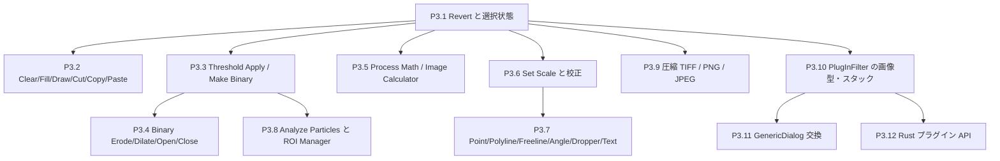

# Phase 3 ロードマップ: 日常の画像編集・解析ワークフロー

Phase 2 で UI の骨格と主要な表示・メニュー機能がそろった。Phase 3 は、ImageJ を日常的に使うときに連続して必要になる「選択する → 画素を編集する → 二値化する → 測る → 保存する」流れを完成させる。対象は `main` の現状（コミット `ab72a51`）で `unsupported` のままになっている機能と、既存の Java プラグイン互換層の入力制限である。

この文書は実装そのものではなく、各タスクを独立した差分として実装・検証するための計画である。`original_imagej/` は読み取り専用の仕様資料であり、編集しない。

## 0. 共通ルール

Phase 2 の [共通ルール](roadmap_phase2_ui_fidelity.md#0-全タスク共通ルール必ず読む) を引き継ぐ。

各タスクは次の順で進める。

1. タスクに記載した Java 実装を先に読み、挙動を `./tools/oracle/run_oracle.sh -eval "..." -batch` で小さな入力について確認する。
2. `crates/ij-session/tests/oracle_parity.rs` に Java オラクルと Rust `Session`/`ImageDocument` を比較する失敗テストを書く。UI のみの部分は `crates/ij-app/tests/` の純粋関数テストまたはヘッドレス egui テストを追加する。
3. 失敗理由を確認してから最小の実装を行う。`ij-core` には純粋な画素・幾何・測定アルゴリズムだけを置き、I/O・UI・クリップボード・サブプロセスはそれぞれ `ij-io`、`ij-app`、`ij-bridge`/`ij-session` の境界に置く。
4. コマンド分類を変更した場合は `python3 tools/ledger/sync_ledger.py` を実行する。生成ファイルを手で編集しない。
5. タスクごとに `./tools/verify.sh` を実行し、最終行が `VERIFY_ALL_OK` になるまで次のタスクへ進まない。

### 0.1 停止条件

- Java ソースとオラクル実測の両方で挙動を決められない。
- 既存の公開データ構造を壊さずに実装できず、設計変更の承認が必要になる。
- 同じ失敗を 3 回修正しても解決しない。
- タスクの非ゴール（例えば Phase 3 後半の GenericDialog 完全再現）が前提になった。
- 画素値や測定値を Rust の出力から逆算して期待値にする必要がある。

停止時は「失敗したテスト、Java 側の根拠、試した代替案、次に必要な判断」を記録して作業を止める。

### 0.2 現在の実装境界

- `crates/ij-app/src/action.rs` の File/Edit/Process/Analyze メニューでは `Revert`、`Cut`、`Copy`、`Paste`、`Clear`、`Fill`、`Draw`、`Process > Binary`、`Process > Math`、`Analyze > Calibrate...` が `unsupported` である。`Set Scale...` と `Analyze Particles...` はまだメニューにない。
- `crates/ij-app/src/tool.rs` の `Tool` enum には全ツールの ID があるが、`is_supported` は Rectangle/Oval/Polygon/Freehand/Line/Wand/Magnifier/Hand に限っている。Polyline、Freeline、Point、Text、Dropper、Angle は対話処理を追加する必要がある。
- `crates/ij-core/src/lib.rs` には `Calibration`、`Roi`、`ImageDocument::save_snapshot`/`undo`、測定とプロファイルの基盤がある。既存の snapshot/undo と calibration を再利用し、別の画素キャッシュを作らない。
- `crates/ij-session/src/lib.rs` の公開 I/O コマンドは `OpenTiff`/`SaveTiff` で、現在のファイル境界は TIFF である。`crates/ij-io/src/lib.rs` の `IoError` と `load_tiff`/`save_tiff` の制約を先に確認し、PNG/JPEG と TIFF 圧縮を一度に混ぜない。
- `crates/ij-bridge/src/plugin.rs` は単一スライス・8-bit グレースケール・既定メタデータ・矩形 ROI（または ROI なし）の plain `PlugInFilter` に限定している。拡張は画像型、スタック、ダイアログの契約を分けて進める。

## 1. 依存関係と優先順位



| 順 | タスク | 難易度 | 完了条件 |
| --- | --- | --- | --- |
| 1 | P3.1 | 🟡 | TIFF の Revert、Select All/None、Restore Selection が pixel/ROI/dirty 状態を再現 |
| 2 | P3.2 | 🔴 | ROI に対する Clear/Fill/Draw/Cut/Copy/Paste と Undo が再現 |
| 3 | P3.3 | 🟡 | Threshold Apply/Make Binary/Convert to Mask が 8-bit から始まり、スタック規則を持つ |
| 4 | P3.4 | 🟡 | 二値画像で Erode/Dilate/Open/Close を反復回数込みで再現 |
| 5 | P3.5 | 🟡 | Math の単画像演算と Image Calculator の 2 画像演算を ROI/型規則込みで再現 |
| 6 | P3.6 | 🟢 | Set Scale と Remove Scale が校正・面積・長さ・表示に反映 |
| 7 | P3.7 | 🔴 | Point/Polyline/Freeline/Angle/Color Picker/Text の作成と計測を有効化 |
| 8 | P3.8 | 🔴 | Analyze Particles と ROI Manager が二値画像から Results/ROI を生成 |
| 9 | P3.9 | 🔴 | 圧縮 TIFF と PNG/JPEG の明示的な読み書き契約を実装 |
| 10 | P3.10 | 🔴 | `DOES_16`/`DOES_32`/`DOES_RGB`/`DOES_STACKS` の安全な PlugInFilter 実行 |
| 11 | P3.11–P3.12 | 🔴 | GenericDialog の限定交換と、型付き Rust プラグイン API を別トラックで安定化 |

表の各行は機能群であり、1 回の大きな変更にまとめない。P3.1 は Revert と選択状態、P3.2 は Clear/Fill/Draw と Copy/Cut/Paste、P3.3 は Gray8 と追加の画素型・スタック、P3.4 は Erode/Dilate と Open/Close、P3.5 は単画像 Math と Image Calculator、P3.7 は ROI 型・ツールごと、P3.8 は粒子抽出と ROI Manager、P3.9 は圧縮方式・画像形式ごと、P3.10 は画素型・スタックごとに分ける。**各小単位で失敗テスト → 実装 → `VERIFY_ALL_OK` → コミット**を完了してから次へ進む。

## 2. タスク詳細

### 実装前の設計チェック（P3.1 の着手時に行う）

**目的**: 後続機能がそれぞれ独自の clipboard、dirty、undo、ROI Manager を持たないよう、既存の `ImageDocument`/`Session` の境界を先に決める。

**最初に読むもの**:

- `crates/ij-core/src/lib.rs:1080-1180`（`ImageDocument` と `Calibration`）および `:2318-2350`（snapshot/undo）。
- `crates/ij-session/src/lib.rs:267-450`（`CommandOutcome`、Session 状態、保存パス）および `:582-620`（Open/Save の dispatch）。
- `crates/ij-app/src/action.rs:100-225,340-470`（メニュー表と enabled 判定）。
- `original_imagej/ij/ImagePlus.java:2187-2283,2890-3035`、`original_imagej/ij/Undo.java:121-202`。

**編集範囲**: `crates/ij-core/src/lib.rs`、`crates/ij-session/src/lib.rs`、必要な `crates/ij-app/src/action.rs` と `crates/ij-app/src/app/`。ledger 変更はスクリプト生成。新しい共有型は serde 可能な純粋データにする。

**P3.1 で先に書くテスト**: `oracle_parity.rs` に画像を保存してから編集し、`Undo`/`File > Revert` 相当の pixel、ROI、calibration、threshold を比較する表を追加する。`action_model_test.rs` では画像なし、ROI なし、保存パスなしの enabled 状態を検証する。

**判断事項**: 既存の `CommandOutcome` と `ImageDocument` の公開利用を壊さず、clipboard/previous ROI/dirty の所有者を一つに決める。これだけを独立タスクとして完了扱いにせず、最初の失敗テストと実装、`VERIFY_ALL_OK` までを P3.1 に含める。

### P3.1 File > Revert と選択状態を実装する 🟡

**Java の根拠**: `original_imagej/ij/plugin/Commands.java:50-56` は active image の `imp.revert()` を呼ぶ。`ImagePlus.java:2187-2204` は ROI を削除前に保存し、`:2245-2283` は Restore Selection の previous ROI を復元する。`:2293-2333` は元の `FileInfo` から再読込し、dirty 状態と current slice を扱う。Selection メニューの分岐は `original_imagej/ij/plugin/Selection.java` を読む。

**実装方針**:

- Session が記録した TIFF path を使い、再読込後に current slice/position、表示範囲、calibration、threshold、ROI の保持・破棄を Java の順序に合わせる。
- `Select All` は image bounds の rectangle ROI、`Select None` は existing `ClearRoi` の previous-ROI 保存を使う。`Restore Selection` は image bounds に収まるときだけ clone し、必要なら中央へ移動する。
- Revert は UI の確認ダイアログと純粋な Session operation を分離する。保存されていない新規画像は明示的なエラーにし、無言で別画像を開かない。

**テスト**: `oracle_parity.rs` に「save → invert/crop/threshold → revert」、`session_ui_correctness.rs` に previous ROI と Select All/None、headless dialog test を追加する。

**非ゴール**: URL/VirtualStack の Revert、overlay の完全再現、OS clipboard。`VERIFY_ALL_OK` が条件。

### P3.2 Edit の画素操作と内部 clipboard を実装する 🔴

**Java の根拠**: `original_imagej/ij/ImagePlus.java:2882-2934`（copy/cut と ROI mask、background fill、Undo）、`:2936-3025`（paste のサイズ・中央配置・paste mode）、`original_imagej/ij/process/ImageProcessor.java:1712-1805`（fill/fill mask/draw ROI）。OS clipboard の扱いは `original_imagej/ij/plugin/Clipboard.java:15-110`。

**実装方針**:

- `ij-core` に ROI bounds と mask を使う Clear/Fill/Draw の pure pixel operations を追加し、Gray8/Gray16/Gray32/RGB の型ごとに丸めとクリップを Java と比較する。
- 内部 clipboard は `Session` が所有する document-independent な snapshot とし、paste は target ROI が clipboard と同サイズならそこへ、違えば visible image center へ配置する。OS clipboard は `ij-app` 境界でのみ扱う。
- `Cut` は copy 後に背景色で塗り、non-rectangular ROI は mask で外側を保持する。各変更は既存 `save_snapshot`/`undo` の一回分として扱う。

**テスト**: `oracle_parity.rs` で各 pixel type の 3x3 ROI、非矩形 mask、clipboard paste 位置、Undo を比較。`crates/ij-app/tests/usability_fidelity_test.rs` で X/C/V/F/D キーとメニューを headless で検証する。

**非ゴール**: overlay flatten、system clipboard の画像形式変換、paste mode 全種類。まず内部 clipboard の Copy/Cut/Paste と macro 記録を完了する。

### P3.3 Threshold Apply / Make Binary / Convert to Mask 🟡

**Java の根拠**: `original_imagej/ij/plugin/Thresholder.java:13-51` が単画像/スタックの入口、`:151-230` が threshold の適用、`original_imagej/ij/process/ImageProcessor.java:2574-2628` が auto threshold、`original_imagej/ij/plugin/frame/ThresholdAdjuster.java` が current threshold と LUT を管理する。

**実装方針**:

- 最初は単一 `Gray8` 画像の `Apply` を実装し、active threshold がない場合の auto-threshold と foreground/background（black background を含む）を明示する。画素を 0/255 に確定し、threshold metadata を Java と同じ時点で reset/keep する。
- 次に Gray16/Gray32 と stack を追加し、`Thresholder.convertStack` の current only / create new stack / local threshold を別コマンド引数にする。
- UI の `Threshold...` palette の Apply ボタンを `AppAction`/`Command` に接続する。menu ledger は script で更新する。

**テスト**: `oracle_parity.rs` で既知 threshold、auto threshold、dark/light background、8-bit stack の current/all slice を比較。`threshold_palette_test.rs` に Apply button の state transition を追加する。

**非ゴール**: `Threshold to Selection`、ColorThresholder、16-bit の全 legacy dialog。まず mask pixel parity を合格させる。

### P3.4 Process > Binary の基本形態学 🟡

**Java の根拠**: `original_imagej/ij/plugin/filter/Binary.java:14-143`（operation、flags、run）、`:145-205`（iterations、Erode/Dilate/Open/Close/Fill）、`original_imagej/ij/process/BinaryProcessor.java:1-220`、`ByteProcessor.erode/dilate` の実装を読む。

**実装方針**:

- P3.3 の binary invariant（0 と 255 のみ）を入口で検証し、Erode/Dilate の `iterations` と `count`、black background、edge padding を型付き設定にする。
- Open = erode → dilate、Close = dilate → erode の順序を固定し、single slice/whole stack の undo policy を ImageJ の PlugInFilterRunner に合わせる。
- `ij-core` の pure morphology を先に実装し、UI の Binary dialog は後から同じ設定型を使う。

**テスト**: Java macro で 5x5 の十字・穴・端接触パターンを生成し、近傍画素数の設定と各 operation の pixel 配列を `oracle_parity.rs` で比較。`stack_process_test.rs` に stack undo/processing scope を追加する。

**非ゴール**: Skeletonize、EDM、Outline、Fill Holes の全オプション。基本形態学後に別タスクとして追加する。

### P3.5 Process > Math と Image Calculator 🟡

**Java の根拠**: `original_imagej/ij/plugin/filter/ImageMath.java:8-140,146-204`（add/sub/mul/div/min/max/gamma/set/log/exp/sqr/sqrt/reciprocal/abs と ROI/stack flags）、`original_imagej/ij/plugin/ImageCalculator.java:19-220`（2 画像の operator、create window、stack compatibility、32-bit promotion）。

**実装方針**:

- 単画像 Math は `ij-core` に型ごとの `f64` 中間値・Java の clip/round 規則を持つ pure function として追加し、ROI mask と stack scope を Session が選ぶ。
- `Image Calculator` は image IDs を受け取り、同じ width/height/type、single-vs-stack broadcasting、result title、create window を Session で管理する。source と destination が同一の場合の snapshot 順序を固定する。
- UI ダイアログは numeric validation と operation selection だけを担い、演算そのものを UI に置かない。

**テスト**: `oracle_parity.rs` で全 operator の小さな Gray8/16/32/RGB 入力、0 除算、NaN/Infinity、ROI、stack broadcasting を比較する。UI では invalid number と cancel を headless test で検証する。

**非ゴール**: `macro` operation の Java parser 完全互換、FFT Math、複雑な color space。`ImageMath.java:206-230` の macro は別設計にする。

### P3.6 Analyze > Set Scale と校正 🟢

**Java の根拠**: `original_imagej/ij/plugin/filter/ScaleDialog.java:13-120`（distance/known/aspect/unit/global と remove scale）、`original_imagej/ij/measure/Calibration.java`（scaled、units、pixelWidth/Height/Depth）、`original_imagej/ij/ImagePlus.java:2206-2216`（removeScale）。

**実装方針**:

- `Calibration` は既に `ij-core` にあるため、`known / measured`、aspect ratio、unit、global flag の入力と validation を追加する。`pixel`/空単位/0 以下は Java の unscale 規則に合わせる。
- Set Scale は line ROI の raw length または rectangle の最大辺を初期値にする。変更後は既存 measurement/profile の calibrated values に反映させ、pixel count 自体は変えない。
- TIFF metadata への校正保存・読込は existing `ij-io` metadata path を確認してから接続する。

**テスト**: Java macro で 10 px line に `known=5, unit=um` を設定し、area/length/profile x increment と saved TIFF reopen を比較。`set_measurements_ui_test.rs` に dialog validation と Remove Scale を追加する。

**非ゴール**: global calibration を複数ウィンドウへ完全反映、空間変換（rotate/scale）そのもの。

### P3.7 追加ツールと ROI 型 🟡

**Java の根拠**: `original_imagej/ij/gui/PolygonRoi.java:33-149,191-248,398-444,585-642`（POLYLINE/FREELINE/ANGLE/POINT の構築と確定）、`original_imagej/ij/gui/PointRoi.java:22-130,700-760`（multi-point/counters）、`original_imagej/ij/gui/Line.java:16-120`（line length/angle）、`original_imagej/ij/gui/Toolbar.java:24-38,398-469,661-690`（tool IDs）。

**実装方針**:

- `ij-core` の `Roi` enum が現在持つ Rect/Oval/Polygon/Line の境界を確認し、Polyline/Freeline/Angle/Point を別 variant として追加する。既存 polygon を無理に再解釈しない。
- angle は calibrated vectors から ImageJ の 0–180/reflex angle 規則を再現し、polyline/freeline は open path として length を測る。point は複数座標と counter mode を保持する。
- `Tool::is_supported`、mouse state、hit testing、macro recording を一つずつ有効化する。Dropper/Text は UI state と pixel sampling/text overlay の責任を分ける。

**テスト**: `tool.rs` の純粋 geometry table test、`roi_interaction_test.rs` の RawInput 操作、`oracle_parity.rs` の line/polyline/angle/point measurement を追加する。既存 Rectangle/Oval/Polygon geometry を変更しない。

**非ゴール**: ShapeRoi boolean、spline fit、overlay の全編集、Text のフォント組版。各ツールの最小作成・移動・計測から始める。

### P3.8 Analyze Particles と ROI Manager 🔴

**Java の根拠**: `original_imagej/ij/plugin/filter/ParticleAnalyzer.java:17-87`（options flags）、`:175-220`（constructor）、`:300-433`（dialog と size/circularity/options）、`:464-520`（analyze setup）、`:879-948`（wand trace、mask、measurement、edge/circularity filter）、`:982-1010`（ROI Manager 追加）。`original_imagej/ij/plugin/frame/RoiManager.java:448-490,2066-2100,2380-2425` も読む。

**実装方針**:

- まず single-slice binary Gray8、8-connected、SHOW_NONE/SHOW_RESULTS/CLEAR_WORKSHEET の最小組を実装する。連結成分、edge exclusion、min/max size、Results row は `ij-core` の pure iterator として出す。
- 次に include holes、circularity、overlay、stack position を追加し、ROI Manager は `Session` が所有する ordered `Vec<RoiEntry>` として実装する。UI は list/select/add/delete/measure の thin layer にする。
- Wand の既存実装は粒子境界の trace に再利用できるが、particle fill で source pixels を破壊する処理はコピー上で行う。結果と source image の mutation を分離する。

**テスト**: 既知の blobs 相当 8-bit binary fixture を Java macro と Rust に渡し、count、area、centroid、perimeter、circularity、edge exclusion、Results column、ROI order を比較する。`particle_analysis_test.rs` を追加する。

**非ゴール**: すべての Show（masks/outlines/ellipses）、redirect image、composite ROI、virtual stack。最小粒子解析が parity を得てから増やす。

### P3.9 圧縮 TIFF と PNG/JPEG I/O 🔴

**Java の根拠**: `original_imagej/ij/io/TiffDecoder.java`（IFD compression/strip/tile 解釈）、`original_imagej/ij/io/FileOpener.java:516-540,585-602`（LZW/compressed stream と pixel reader）、`original_imagej/ij/io/FileInfo.java:89-113`（compression constants）、`original_imagej/ij/io/Opener.java:330-365,749-760`（JPEG/PNG dispatch）、`original_imagej/ij/plugin/PNG_Writer.java:11-65,101-105`、`original_imagej/ij/plugin/JpegWriter.java:18-85`。

**実装方針**:

- 形式ごとに capability matrix を先に作る。TIFF は uncompressed → PackBits → Deflate → LZW の順、PNG は Gray8/Gray16/RGB、JPEG は Gray8/RGB の lossy 明示契約とする。JPEG の pixel-exact parity は要求せず、encoder quality と round-trip 誤差を別基準にする。
- `ij-io` の decoder/encoder を純粋 byte parser と filesystem wrapper に分け、外部 crate を使う場合も `ij-core` に依存を持ち込まない。既存 `load_tiff`/`save_tiff` の metadata と atomic save safety を保持する。
- `Session::OpenTiff/SaveTiff` を拡張する前に `OpenImage`/`SaveImage` の format enum を設計し、拡張子だけでなく magic bytes と explicit format を優先する。

**テスト**: Java `FileSaver`/`Opener` で生成した圧縮 TIFF、PNG、JPEG fixture を Rust で開き、shape/type/calibration/representative pixels を比較する。Rust の保存物を Java で再読込する逆向きテストも行う。既存 `save_tiff_atomicity.rs` を回帰にする。

**非ゴール**: DICOM/AVI/GIF、virtual stack、OME-TIFF の全メタデータ。codec の追加は一形式ごとに `VERIFY_ALL_OK` を挟む。

### P3.10 PlugInFilter の画像型・スタック互換 🔴

**Java の根拠**: `original_imagej/ij/plugin/filter/PlugInFilter.java:10-91`（capability flags）、`original_imagej/ij/plugin/filter/PlugInFilterRunner.java:48-120,156-162,397-425`（setup、stack dispatch、undo、type validation）。

**実装方針**:

- inspection/host protocol の JSON に setup flags、accepted bit depths、DOES_STACKS、SUPPORTS_MASKING、NO_UNDO/NO_CHANGES を追加する。既存の plain filter ticket を壊さず versioned protocol にする。
- Gray16、Gray32、RGB の TIFF transfer を型ごとに検証し、plugin flags が要求しない型を開始前に拒否する。DOES_STACKS がない plugin は current slice のみ、ある plugin は stack planes を順番に渡す。
- `NO_UNDO`/`NO_CHANGES`/`SNAPSHOT` の扱いを既存 `plugin_undo_policy` と一致させ、plugin が calibration/ROI/metadata を変えた場合は ticket stale として破棄する。

**テスト**: `crates/ij-bridge/tests/plugin_filter_compatibility.rs` と `crates/ij-session/tests/plugin_filter_integration.rs` に、各 flag 組み合わせの fixture plugin（8/16/32/RGB、single/stack、mask/no-mask）を追加する。Java host の stdout/stderr と Rust document revision を比較する。

**非ゴール**: AWT window、ExtendedPlugInFilter の preview、GenericDialog。これらは P3.11 で別 protocol にする。

### P3.11 GenericDialog の限定交換 🔴

**Java の根拠**: `original_imagej/ij/gui/GenericDialog.java:44-105,325-505,604-640,1566-1701`、`original_imagej/ij/plugin/filter/PlugInFilterRunner.java:22-48,585-620`。

**方針**: Java host が表示した dialog を Rust UI へ丸ごと転送するのではなく、numeric/string/choice/checkbox の宣言と default、validation、cancel/OK を JSON で交換する。最初は `GenericDialog` を一つだけ使う fixture pluginで、preview callback と arbitrary AWT component は拒否する。

**テストと受け入れ条件**: headless egui で dialog schema から同じ field order/default を生成し、OK/Cancel の結果を Java plugin が受け取ることを確認する。未知 field type は明示的な unsupported error にする。

### P3.12 Rust プラグイン API 🔴

**方針**: Java compatibility path と混ぜず、Rust plugin API を別 crate（候補: `ij-plugin-api`）として設計する。画像 plane、ROI、calibration、Results writer、undo policy を typed trait で表し、UI や filesystem を plugin trait に渡さない。まず in-process test plugin と versioned API を作り、将来の dynamic loading は別判断にする。

**受け入れ条件**: Rust plugin が `ImageDocument` の clone/transaction を受け取り、成功時だけ Session に commit、失敗時は元画像を変えない。Java plugin の classpath や GenericDialog を API に漏らさない。

## 3. 各タスクの報告形式

```text
TASK: P3.x
STATUS: done | stopped
CHANGED: <ファイル一覧>
NEW TESTS: <テスト名一覧>
VERIFY: VERIFY_ALL_OK | stopped with reason
JAVA REFERENCES: <読んだファイルと行番号>
NOTES: <pixel/measurement/UI parity、未実装範囲、次の依存>
```

Phase 3 の終了条件は、P3.1–P3.9 のうち日常ワークフローに必要な機能が `unsupported` から消え、編集→二値化→粒子計測→ROI 再利用→保存/再読込を一つの headless journey で通せること、ならびに毎タスクの `VERIFY_ALL_OK` が履歴に残ることである。P3.10–P3.12 は互換性の拡張トラックとして、コアワークフローの parity を壊さない順序で進める。
