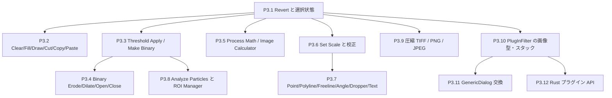

# Phase 3 ロードマップ: 日常の画像編集・解析ワークフロー

Phase 2 で UI の骨格と主要な表示・メニュー機能がそろった。Phase 3 は、ImageJ を日常的に使うときに連続して必要になる「選択する → 画素を編集する → 二値化する → 測る → 保存する」流れを完成させる。対象は `main` の現状（コミット `ab72a51`）で `unsupported` のままになっている機能と、既存の Java プラグイン互換層の入力制限である。

この文書は実装そのものではなく、各タスクを独立した差分として実装・検証するための計画である。`original_imagej/` は読み取り専用の仕様資料であり、編集しない。

## 0. 共通ルール

Phase 2 の [共通ルール](roadmap_phase2_ui_fidelity.md#0-全タスク共通ルール必ず読む) を引き継ぐ。

各タスクは次の順で進める。

1. タスクに記載した Java 実装を先に読み、挙動を `./tools/oracle/run_oracle.sh -eval "..." -batch` で小さな入力について確認する。
2. `crates/ij-session/tests/oracle_parity.rs` に Java オラクルと Rust `Session`/`ImageDocument` を比較する失敗テストを書く。UI のみの部分は `crates/ij-app/tests/` の純粋関数テストまたはヘッドレス egui テストを追加する。
3. 失敗理由を確認してから最小の実装を行う。`ij-core` には純粋な画素・幾何・測定アルゴリズムだけを置き、I/O・UI・クリップボード・サブプロセスはそれぞれ `ij-io`、`ij-app`、`ij-bridge`/`ij-session` の境界に置く。
4. コマンド分類を変更した場合は `python3 tools/ledger/sync_ledger.py` を実行する。生成ファイルを手で編集しない。
5. タスクごとに `./tools/verify.sh` を実行し、最終行が `VERIFY_ALL_OK` になるまで次のタスクへ進まない。

### 0.1 停止条件

- Java ソースとオラクル実測の両方で挙動を決められない。
- 既存の公開データ構造を壊さずに実装できず、設計変更の承認が必要になる。
- 同じ失敗を 3 回修正しても解決しない。
- タスクの非ゴール（例えば Phase 3 後半の GenericDialog 完全再現）が前提になった。
- 画素値や測定値を Rust の出力から逆算して期待値にする必要がある。

停止時は「失敗したテスト、Java 側の根拠、試した代替案、次に必要な判断」を記録して作業を止める。

### 0.2 現在の実装境界

- `crates/ij-app/src/action.rs` の File/Edit/Process/Analyze メニューでは `Revert`、`Cut`、`Copy`、`Paste`、`Clear`、`Fill`、`Draw`、`Process > Binary`、`Process > Math`、`Analyze > Calibrate...` が `unsupported` である。`Set Scale...` と `Analyze Particles...` はまだメニューにない。
- `crates/ij-app/src/tool.rs` の `Tool` enum には全ツールの ID があるが、`is_supported` は Rectangle/Oval/Polygon/Freehand/Line/Wand/Magnifier/Hand に限っている。Polyline、Freeline、Point、Text、Dropper、Angle は対話処理を追加する必要がある。
- `crates/ij-core/src/lib.rs` には `Calibration`、`Roi`、`ImageDocument::save_snapshot`/`undo`、測定とプロファイルの基盤がある。既存の snapshot/undo と calibration を再利用し、別の画素キャッシュを作らない。
- `crates/ij-session/src/lib.rs` の公開 I/O コマンドは `OpenTiff`/`SaveTiff` で、現在のファイル境界は TIFF である。`crates/ij-io/src/lib.rs` の `IoError` と `load_tiff`/`save_tiff` の制約を先に確認し、PNG/JPEG と TIFF 圧縮を一度に混ぜない。
- `crates/ij-bridge/src/plugin.rs` は単一スライス・8-bit グレースケール・既定メタデータ・矩形 ROI（または ROI なし）の plain `PlugInFilter` に限定している。拡張は画像型、スタック、ダイアログの契約を分けて進める。

## 1. 依存関係と優先順位

| 順 | タスク | 難易度 | 完了条件 |
| --- | --- | --- | --- |
| 1 | P3.1 | 🟡 | TIFF の Revert、Select All/None、Restore Selection が pixel/ROI/dirty 状態を再現 |
| 2 | P3.2 | 🔴 | ROI に対する Clear/Fill/Draw/Cut/Copy/Paste と Undo が再現 |
| 3 | P3.3 | 🟡 | Threshold Apply/Make Binary/Convert to Mask が 8-bit から始まり、スタック規則を持つ |
| 4 | P3.4 | 🟡 | 二値画像で Erode/Dilate/Open/Close を反復回数込みで再現 |
| 5 | P3.5 | 🟡 | Math の単画像演算と Image Calculator の 2 画像演算を ROI/型規則込みで再現 |
| 6 | P3.6 | 🟢 | Set Scale と Remove Scale が校正・面積・長さ・表示に反映 |
| 7 | P3.7 | 🔴 | Point/Polyline/Freeline/Angle/Color Picker/Text の作成と計測を有効化 |
| 8 | P3.8 | 🔴 | Analyze Particles と ROI Manager が二値画像から Results/ROI を生成 |
| 9 | P3.9 | 🔴 | 圧縮 TIFF と PNG/JPEG の明示的な読み書き契約を実装 |
| 10 | P3.10 | 🔴 | `DOES_16`/`DOES_32`/`DOES_RGB`/`DOES_STACKS` の安全な PlugInFilter 実行 |
| 11 | P3.11–P3.12 | 🔴 | GenericDialog の限定交換と、型付き Rust プラグイン API を別トラックで安定化 |

表の各行は機能群であり、1 回の大きな変更にまとめない。P3.1 は Revert と選択状態、P3.2 は Clear/Fill/Draw と Copy/Cut/Paste、P3.3 は Gray8 と追加の画素型・スタック、P3.4 は Erode/Dilate と Open/Close、P3.5 は単画像 Math と Image Calculator、P3.7 は ROI 型・ツールごと、P3.8 は粒子抽出と ROI Manager、P3.9 は圧縮方式・画像形式ごと、P3.10 は画素型・スタックごとに分ける。**各小単位で失敗テスト → 実装 → `VERIFY_ALL_OK` → コミット**を完了してから次へ進む。

## 2. サブエージェント向け詳細設計（P3.0–P3.12、全 26 ステップ）

ここからの各ユニットは、1 回のサブエージェント呼び出しで **「失敗テスト作成 → 最小実装 → `./tools/verify.sh` で `VERIFY_ALL_OK` → 1 コミット」** まで完結する粒度に分けています。

---

### P3.0 ビルド生成 JAR の追跡解除と旧作業ブランチの掃除 🟢

- **現状（実測）**:
  1. `tools/plugin-host/plugin-host.jar` と `tools/plugin-host/fixtures/fixtures.jar` が git 追跡対象になっているため、`./tools/verify.sh` 実行のたびにタイムスタンプ差分で `git status` が汚れる。
  2. `t3/*` のローカル作業ブランチが 8 本残っている（内容はすべて `main` に統合済み）。
- **編集してよいファイル**: `.gitignore`（および `git rm --cached`）
- **手順**:
  1. `.gitignore` に `/tools/plugin-host/plugin-host.jar` と `/tools/plugin-host/fixtures/fixtures.jar` を追加し、`git rm --cached tools/plugin-host/plugin-host.jar tools/plugin-host/fixtures/fixtures.jar` を実行する（ディスク上のファイルは残す）。
  2. `git branch -D $(git branch --list 't3/*')` でローカルの旧作業ブランチ 8 本を削除する。
  3. `./tools/verify.sh` を実行し、完了後に `git status --short` が完全に空であることを確認する。
- **受け入れ条件**: `./tools/verify.sh` 実行直後に `git status --short` が空出力。`VERIFY_ALL_OK`。

---

### P3.1 選択状態の復元と `Revert`（P3.1a は完了済み）

- **P3.1a（完了済み `24e80d6`）**: `File > Revert`（`Cmd+R`）と変更確認ダイアログ、TIFF 再読込、ROI 保持。

#### P3.1b `Edit > Selection > Select All`（`Cmd+A`）と `Restore Selection`（`Shift+E`）🟢
- **ゴール**: `Select All` で画像全体の矩形 ROI が作られ、ROI のクリアや上書き時に直前の ROI が `Session.previous_roi` に保存され、`Restore Selection`（`Shift+E`）で復元される。
- **最初に読むもの**:
  - [Selection.java:29-46](file:///Users/nauti/GitHub/ImageJ-rs/original_imagej/ij/plugin/Selection.java#L29-L46)（`all`, `none`, `restore`）
  - [ImagePlus.java:2245-2285](file:///Users/nauti/GitHub/ImageJ-rs/original_imagej/ij/ImagePlus.java#L2245-L2285)（`saveRoi`, `restoreRoi` のはみ出し判定と中央移動 `(width - r.width) / 2`, `(height - r.height) / 2`）
- **編集してよいファイル**:
  - `crates/ij-core/src/lib.rs`
  - `crates/ij-session/src/lib.rs`
  - `crates/ij-session/tests/oracle_parity.rs`
  - `crates/ij-app/src/action.rs`
  - `crates/ij-app/src/app/shortcuts.rs`
  - `crates/ij-app/tests/roi_interaction_test.rs`
- **厳密な仕様**:
  1. `Session` に `pub previous_roi: Option<Roi>` を持たせる。`ClearRoi`, `SelectAll`, または新しい `Make*Roi` で既存の `doc.roi`（幅または高さ `> 0`）が消える直前に `self.previous_roi = doc.roi.clone()` を保存する（`ImagePlus.saveRoi`）。
  2. `Command::SelectAll`（マクロ記録 `"run(\"Select All\");\n"`）: 現在の `doc.roi` を `previous_roi` に退避し、`Roi::Rect(RectRoi::new(0, 0, doc.width as i32, doc.height as i32))` をセットする。
  3. `Command::RestoreSelection`（マクロ記録 `"run(\"Restore Selection\");\n"`）: `previous_roi` が `Some(prev)` のとき、`ImagePlus.restoreRoi`（`ImagePlus.java:2268-2277`）の条件に従って復元する。ROI のバウンディングボックス `r` が画像外（`r.x >= w || r.y >= h || r.x + r.width < 0 || r.y + r.height < 0`）なら `((w - r.width) / 2, (h - r.height) / 2)` に平行移動し、`r.width == w && r.height == h` なら `(0, 0)` に配置する。
  4. `AppAction::SelectAll`（`Cmd+A`）と `AppAction::RestoreSelection`（`Shift+E`）を `EDIT_SELECTION` メニューとショートカットに追加。
- **先に書くテスト**:
  - `oracle_parity.rs`: 矩形・楕円・多角形 ROI を作成 → `Select None` → `Restore Selection` → `Measure` の結果がオラクルと一致。別サイズの画像に対する `Restore Selection` の中央再配置がオラクルと一致。
- **受け入れ条件**: `./tools/verify.sh` が `VERIFY_ALL_OK`。

---

### P3.2 `Edit` の画素操作（Clear / Fill / Draw）と内部クリップボード（Copy / Cut / Paste）

#### P3.2a `Edit > Clear` / `Fill`（`F`）/ `Draw`（`D`）と前景色・背景色 🟡
- **ゴール**: 前景色（既定：黒 `0, 0, 0`）と背景色（既定：白 `255, 255, 255`）に基づき、現在スライス（または ROI 内部／輪郭）に対する `Clear`, `Fill`, `Draw` が 5 種の `PixelPlane` すべてで ImageJ と完全一致する。
- **最初に読むもの**:
  - [Filler.java:18-175](file:///Users/nauti/GitHub/ImageJ-rs/original_imagej/ij/plugin/filter/Filler.java#L18-L175)（`clear`, `fill`, `draw`）
  - [ImageProcessor.java:1712-1820](file:///Users/nauti/GitHub/ImageJ-rs/original_imagej/ij/process/ImageProcessor.java#L1712-L1820)（`fill()`, `fill(Roi)`, `drawRoi(Roi)`）
  - `ByteProcessor.java`, `ShortProcessor.java`, `FloatProcessor.java`, `ColorProcessor.java` の `setColor(Color)` が RGB 色をどの画素値（例: Gray8 なら輝度またはパレット最近傍、Gray16/32 なら display_range の min/max または輝度換算）に変換するかを必ずオラクル実測で確認すること！
- **編集してよいファイル**:
  - `crates/ij-core/src/lib.rs`
  - `crates/ij-session/src/lib.rs`
  - `crates/ij-session/tests/oracle_parity.rs`
  - `crates/ij-app/src/action.rs`
  - `crates/ij-app/src/app/mod.rs`
  - `crates/ij-app/src/app/shortcuts.rs`
- **仕様**:
  - `Session` に `foreground_color: [u8; 3]`（初期値 `[0, 0, 0]`）と `background_color: [u8; 3]`（初期値 `[255, 255, 255]`）を持たせる（`Command::SetForegroundColor`, `Command::SetBackgroundColor`）。
  - `ImageDocument::clear_roi_or_plane(&mut self, bg: [u8; 3])`, `fill_roi_or_plane(&mut self, fg: [u8; 3])`, `draw_roi(&mut self, fg: [u8; 3])`:
    - 実行前に `self.save_snapshot()` を呼ぶ。
    - `Clear` と `Fill` は面積 ROI があれば `roi_mask` 内の画素のみ、ROI なしならスライス全体を塗る。
    - `Draw` は ROI が必須（ROI なしならエラー）。ROI の 1px 輪郭線（`Roi.drawPixels(ip)` と同じラスタライズ規則）を前景色で描く。
  - `EDIT_MENU` の `Clear`, `Fill` (`F`), `Draw` (`D`) を `unsupported` から `item` に切り替える。
- **先に書くテスト**: `oracle_parity.rs` で矩形・楕円・多角形・線分 ROI に対して `run("Clear")`, `run("Fill")`, `run("Draw")` を実行し、画素がオラクルと一致すること。

#### P3.2b `Edit > Copy`（`C`）/ `Cut`（`X`）/ `Paste`（`V`）🟡
- **ゴール**: `Session` 内の内部クリップボードを使って、選択領域（または画像全体）の `Copy`, `Cut`, `Paste` と `Undo` が動作する。
- **最初に読むもの**:
  - [ImagePlus.java:2882-3025](file:///Users/nauti/GitHub/ImageJ-rs/original_imagej/ij/ImagePlus.java#L2882-L3025)（`cut()`, `copy(boolean cut)`, `paste()`）
- **編集してよいファイル**:
  - `crates/ij-core/src/lib.rs`
  - `crates/ij-session/src/lib.rs`
  - `crates/ij-session/tests/oracle_parity.rs`
  - `crates/ij-app/src/action.rs`
  - `crates/ij-app/src/app/shortcuts.rs`
- **仕様**:
  - `Copy`: 面積 ROI があればそのバウンディングボックスを切り抜いた `ClipboardBuffer { width, height, plane: PixelPlane, mask: Option<RoiMask> }` を `Session.clipboard` に保存。ROI なしなら現在スライス全体を保存。
  - `Cut`: 面積 ROI が必須（Java `ImagePlus.java:2901`）。`Copy` 実行後、`save_snapshot()` して面積 ROI 内を背景色で塗る。
  - `Paste`: `Session.clipboard` が `Some` のとき、`save_snapshot()` してターゲット画像の現在スライスへ貼り付ける。配置座標は、ターゲットに同じサイズの面積 ROI があればその左上 `(rx, ry)`、なければ画像中央 `((w - cw) / 2, (h - ch) / 2)`（`ImagePlus.java:2960-2975` の規則に合わせる）。非矩形マスクがある場合はマスク内画素のみ上書きする。
  - `EDIT_MENU` の `Cut` (`X`), `Copy` (`C`), `Paste` (`V`) を有効化する。
- **先に書くテスト**: `oracle_parity.rs` で (a) 矩形 ROI の Copy → 別位置の同サイズ ROI へ Paste、(b) 楕円 ROI の Cut → ROI 無し画像への Paste（中央配置とマスク透過）、(c) Paste 後の `Undo` をオラクルと比較。

---

### P3.3 `Threshold > Apply` と `Process > Binary > Make Binary / Convert to Mask`

#### P3.3a 単一画像の二値化確定（`Apply` / `Make Binary` / `Convert to Mask`）🟡
- **ゴール**: 閾値設定済み（または未設定時に自動 `IsoData` 閾値を計算した）画像を `0` と `255` の 8-bit 二値画像へ変換し、Threshold パレットの `Apply` ボタンおよび `Process > Binary > Make Binary` / `Convert to Mask` メニューから実行できる。
- **最初に読むもの**:
  - [Thresholder.java:13-230](file:///Users/nauti/GitHub/ImageJ-rs/original_imagej/ij/plugin/Thresholder.java#L13-L230)（`applyThreshold`, `convertToByte`, `BlackBackground` の扱い: デフォルト `Prefs.blackBackground` が `false` のとき前景=255/背景=0 か、inverting LUT がどうなるかを必ずオラクル実測で確認！）
  - [ThresholdAdjuster.java:749-830](file:///Users/nauti/GitHub/ImageJ-rs/original_imagej/ij/plugin/frame/ThresholdAdjuster.java#L749-L830)
- **編集してよいファイル**:
  - `crates/ij-core/src/lib.rs`
  - `crates/ij-session/src/lib.rs`
  - `crates/ij-session/tests/oracle_parity.rs`
  - `crates/ij-app/src/action.rs`
  - `crates/ij-app/src/app/threshold_palette.rs`
  - `crates/ij-app/tests/threshold_palette_test.rs`
- **仕様**:
  - `ImageDocument::apply_threshold(&mut self, black_background: bool) -> Result<(), CoreError>`:
    - 閾値が `None` の場合、8-bit / 16-bit なら既定の `IsoData`（`dark_background = black_background`）で閾値を自動決定してから適用する。
    - `Gray16` / `Gray32` の場合は 8-bit `Gray8` に変換した上で、元の閾値範囲 `[lower, upper]` に入る画素を前景値（`black_background == true` なら `255`、`false` の既定挙動はオラクル実測値に合わせる）、範囲外を背景値にし、`self.threshold = None` にリセットする。
  - `Command::ApplyThreshold { black_background: bool }`（マクロ記録 `"setOption(\"BlackBackground\", ...);\nrun(\"Convert to Mask\");\n"` または `"run(\"Make Binary\");\n"`）。
  - `threshold_palette.rs` の `Apply` ボタンを有効化して接続。

#### P3.3b スタック画像の二値化（`Convert Stack to Binary`）🟢
- **ゴール**: 複数スライスのスタック画像に対しても `Make Binary` / `Convert to Mask` が動作する（全スライス一括または各スライス自動計算のオプション対応）。
- **最初に読むもの**: [Thresholder.java:70-150](file:///Users/nauti/GitHub/ImageJ-rs/original_imagej/ij/plugin/Thresholder.java#L70-L150)
- **編集してよいファイル**: `crates/ij-core/src/lib.rs`, `crates/ij-session/src/lib.rs`, `crates/ij-session/tests/oracle_parity.rs`, `crates/ij-app/src/app/threshold_palette.rs`, `crates/ij-app/src/app/adjust_dialogs.rs`
- **先に書くテスト**: 3スライス 8-bit / 16-bit スタックの二値化がオラクルの `run("Convert to Mask", "method=Otsu background=Dark calculate black")` および固定閾値適用と完全一致。

---

### P3.4 `Process > Binary` のモルフォロジー演算（Erode / Dilate / Open / Close）🟡

- **ゴール**: 8-bit 二値画像（画素値が `0` と `255` のみ）に対して `Erode`, `Dilate`, `Open`, `Close` が動作し、`Process > Binary` サブメニューから実行できる（スタック時の `Process Stack?` 対応を含む）。
- **最初に読むもの**:
  - [Binary.java:14-205](file:///Users/nauti/GitHub/ImageJ-rs/original_imagej/ij/plugin/filter/Binary.java#L14-L205)
  - [BinaryProcessor.java:1-220](file:///Users/nauti/GitHub/ImageJ-rs/original_imagej/ij/process/BinaryProcessor.java#L1-L220)
  - [ByteProcessor.java](file:///Users/nauti/GitHub/ImageJ-rs/original_imagej/ij/process/ByteProcessor.java) の `erode(int count, int background)` / `dilate(int count, int background)`（画像境界の外側画素をどう扱うか要確認！）
- **編集してよいファイル**:
  - `crates/ij-core/src/filters.rs`
  - `crates/ij-core/src/lib.rs`
  - `crates/ij-session/src/lib.rs`
  - `crates/ij-session/tests/oracle_parity.rs`
  - `crates/ij-app/src/stack_process.rs`
  - `crates/ij-app/src/action.rs`
  - `crates/ij-app/src/app/mod.rs`
- **仕様**:
  - 入力平面が `Gray8` でかつ全画素が `0` または `255` でない場合は `CoreError::InvalidOperation("8-bit binary (0 and 255 only) image required.")` を返す（`Binary.java` と同じチェック）。
  - `Open` は `erode` の後に `dilate`、`Close` は `dilate` の後に `erode`。
  - `PROCESS_MENU` の `unsupported("Binary", None)` を `submenu("Binary", PROCESS_BINARY)`（`Make Binary`, `Convert to Mask`, `Erode`, `Dilate`, `Open`, `Close`）に置き換える。
- **先に書くテスト**: `oracle_parity.rs` で孤立点・穴・画像境界に接する矩形を含む二値パターンに対し、`Erode`, `Dilate`, `Open`, `Close`（単一画像・ROI あり・スタック全体）の画素がオラクルと完全一致。

---

### P3.5 `Process > Math` と `Process > Image Calculator...`

#### P3.5a 単画像 `Process > Math`（Add / Subtract / Multiply / Divide / Min / Max / Gamma / Log / Exp / Square / Square Root / Reciprocal / Abs / Set）🟡
- **最初に読むもの**:
  - [ImageMath.java:14-205](file:///Users/nauti/GitHub/ImageJ-rs/original_imagej/ij/plugin/filter/ImageMath.java#L14-L205)
  - 各 `ImageProcessor`（`ByteProcessor`, `ShortProcessor`, `FloatProcessor`, `ColorProcessor`）の `add(double)`, `multiply(double)`, `gamma(double)`, `log()`, `exp()`, `sqr()`, `sqrt()`, `abs()` 等の実装（特に 8-bit / 16-bit での `log()` / `exp()` のスケール係数と丸め・飽和クランプ規則を必ず Java 原文で確認すること！）。
- **編集してよいファイル**:
  - `crates/ij-core/src/filters.rs`（または新規 `crates/ij-core/src/math.rs`）
  - `crates/ij-core/src/lib.rs`
  - `crates/ij-session/src/lib.rs`
  - `crates/ij-session/tests/oracle_parity.rs`
  - `crates/ij-app/src/stack_process.rs`
  - `crates/ij-app/src/action.rs`
  - `crates/ij-app/src/dialogs.rs`
  - `crates/ij-app/src/app/adjust_dialogs.rs`
  - `crates/ij-app/src/app/mod.rs`
- **先に書くテスト**: `oracle_parity.rs` で Gray8 / Gray16 / Gray32 / ColorRgb（および ROI・スタック）に対する各 Math 演算の結果がオラクルと完全一致。

#### P3.5b 2 画像間演算 `Process > Image Calculator...` 🟡
- **最初に読むもの**:
  - [ImageCalculator.java:19-220](file:///Users/nauti/GitHub/ImageJ-rs/original_imagej/ij/plugin/ImageCalculator.java#L19-L220)（12 演算: `Add`, `Subtract`, `Multiply`, `Divide`, `AND`, `OR`, `XOR`, `Min`, `Max`, `Average`, `Difference`, `Copy`, `Transparent-zero`、および `createWindow` と `floatResult`（32-bit 出力）オプション）
- **編集してよいファイル**:
  - `crates/ij-core/src/math.rs`
  - `crates/ij-session/src/lib.rs`
  - `crates/ij-session/tests/oracle_parity.rs`
  - `crates/ij-app/src/action.rs`
  - `crates/ij-app/src/dialogs.rs`
  - `crates/ij-app/src/app/adjust_dialogs.rs`
- **先に書くテスト**: `oracle_parity.rs` で 2 枚の画像に対する `imageCalculator("Add create", ...)` / `"Subtract create 32-bit"` / `"Difference"` 等がオラクルと完全一致。

---

### P3.6 `Analyze > Set Scale...` と空間校正ダイアログ 🟢

- **ゴール**: `Analyze > Set Scale...` ダイアログから `Distance in pixels`, `Known distance`, `Pixel aspect ratio`, `Unit of length`（および `Click to Remove Scale`）を設定でき、計測値（`Area`, `Length`, `Perim.`）、プロファイル横軸、ステータスバー座標、サブタイトル実寸表記、保存 TIFF に即座に反映される。
- **最初に読むもの**:
  - [ScaleDialog.java:13-140](file:///Users/nauti/GitHub/ImageJ-rs/original_imagej/ij/plugin/filter/ScaleDialog.java#L13-L140)
  - [ImagePlus.java:2206-2216](file:///Users/nauti/GitHub/ImageJ-rs/original_imagej/ij/ImagePlus.java#L2206-L2216)
- **編集してよいファイル**:
  - `crates/ij-core/src/lib.rs`
  - `crates/ij-session/src/lib.rs`
  - `crates/ij-session/tests/oracle_parity.rs`
  - `crates/ij-app/src/action.rs`
  - `crates/ij-app/src/dialogs.rs`
  - `crates/ij-app/src/app/adjust_dialogs.rs`
  - `crates/ij-app/src/app/mod.rs`
- **仕様**:
  - ダイアログを開いたとき、アクティブ画像に `Roi::Line` があればそのピクセル長さを `Distance in pixels` の初期値に入れる（`ScaleDialog.java:42-53`）。
  - `pixel_width = known_distance / distance_in_pixels`, `pixel_height = pixel_width * aspect_ratio`。`distance <= 0` または `known <= 0` または `unit` が `"pixel"` / 空のときは未校正（`1.0, 1.0, "pixel"`）にリセットする。
  - `Command::SetScale { distance: f64, known: f64, aspect: f64, unit: String }`（マクロ記録 `"run(\"Set Scale...\", \"distance=... known=... pixel=... unit=...\");\n"`）。
- **先に書くテスト**: `oracle_parity.rs` で `Set Scale...` 実行後の `Measure`（Area, Perim., Centroid, Length）および TIFF 保存・再読込後の校正値がオラクルと一致。

---

### P3.7 残りの全ツールバー 6 種の実装（Point / Polyline / Freeline / Angle / Dropper / Text）

14 個のツールバー枠のうち未有効の 6 ツールを 3 ステップに分けてすべて有効化し、`Tool::is_supported` を全ツール `true` にする。

#### P3.7a `Point`（マルチポイント）と `Angle` ツール 🟡
- **最初に読むもの**:
  - [PointRoi.java:22-130](file:///Users/nauti/GitHub/ImageJ-rs/original_imagej/ij/gui/PointRoi.java#L22-L130)
  - [Analyzer.java:382-430](file:///Users/nauti/GitHub/ImageJ-rs/original_imagej/ij/plugin/filter/Analyzer.java#L382-L430)（`measurePoint`, `measureAngle`）
  - [PolygonRoi.java:398-444](file:///Users/nauti/GitHub/ImageJ-rs/original_imagej/ij/gui/PolygonRoi.java#L398-L444)（`getAngle`: 3 頂点からの角度計算）
- **編集してよいファイル**: `crates/ij-core/src/lib.rs`, `crates/ij-io/src/lib.rs`（ROI シリアライズ対応または明示対応）, `crates/ij-session/src/lib.rs`, `crates/ij-session/tests/oracle_parity.rs`, `crates/ij-app/src/tool.rs`, `crates/ij-app/src/roi_edit.rs`, `crates/ij-app/src/app/image_window.rs`
- **仕様**:
  - `Roi::Point(PointRoi { points: Vec<(i32, i32)> })` と `Roi::Angle(AngleRoi { points: [(i32, i32); 3] })` を追加。
  - `Point` の `Measure` は各点ごとに `X`, `Y`, およびその画素値（`Mean`/`Min`/`Max`/`Mode` 等すべて同じ単一画素値、`Area = 0`）を Results に追加する（`Analyzer.measurePoint` と一致させる）。
  - `Angle` の `Measure` は 3 点のなす角（`0..=180` 度、校正考慮）を `Angle` 列に出力する。
- **先に書くテスト**: `oracle_parity.rs` で `makePoint(x, y)` と `makeSelection("angle", ...)` の `Measure` 出力がオラクルと一致。

#### P3.7b `Segmented Line`（`Polyline`）と `Freehand Line`（`Freeline`）ツール 🟡
- **最初に読むもの**:
  - [PolygonRoi.java:250-395](file:///Users/nauti/GitHub/ImageJ-rs/original_imagej/ij/gui/PolygonRoi.java#L250-L395)（`POLYLINE`, `FREELINE` の `getLength()`）
  - [ProfilePlot.java:236-290](file:///Users/nauti/GitHub/ImageJ-rs/original_imagej/ij/gui/ProfilePlot.java#L236-L290)（`getIrregularProfile`）
- **編集してよいファイル**: `crates/ij-core/src/lib.rs`, `crates/ij-session/src/lib.rs`, `crates/ij-session/tests/oracle_parity.rs`, `crates/ij-app/src/tool.rs`, `crates/ij-app/src/roi_edit.rs`, `crates/ij-app/src/app/image_window.rs`
- **仕様**:
  - `Roi::Polyline(PolylineRoi { points: Vec<(i32, i32)>, freehand: bool })` を追加。`is_area()` は `false`、`is_line()` は `true`。
  - 各線分長の合計（校正考慮）を `Length` とし、`Measure` および `Plot Profile`（`getIrregularProfile`）に対応させる。
- **先に書くテスト**: `oracle_parity.rs` で `makeLine(x1, y1, x2, y2, x3, y3)` の `Measure`（Length, Mean, Min, Max）と `getProfile()` がオラクルと一致。

#### P3.7c `Color Picker`（`Dropper`）と `Text` ツール 🟢
- **最初に読むもの**:
  - `Toolbar.java` および `ImageCanvas.java` の `DROPPER` 処理（クリックで前景色、Alt+クリックで背景色を画像画素からスポイト取得）
  - `TextRoi.java`（またはクリック位置にテキストスタンプを `Fill` / `Draw` で焼き込む最小実装）
- **編集してよいファイル**: `crates/ij-app/src/tool.rs`, `crates/ij-app/src/app/image_window.rs`, `crates/ij-app/src/app/mod.rs`, `crates/ij-app/tests/dropper_and_text_tool_test.rs`（新規）
- **仕様**:
  - `Dropper`: 画像上の画素をクリックすると、その画素の RGB 表示色を `Session.foreground_color`（Alt 押下時は `background_color`）にセットし、ステータスバーに `Foreground color: (R, G, B)` を表示する。
  - `Text`: クリックで矩形とテキスト入力状態を作り、`Edit > Draw`（`D`）でビットマップフォント（5×7 または 8×8 の組み込み ASCII グリフ）を前景色で画素に描画する。これで 14 個すべてのツールが有効（`Tool::is_supported` が全件 `true`）になる。

---

### P3.8 `Analyze > Analyze Particles...` と `ROI Manager`

#### P3.8a 粒子解析コアエンジン（`ij-core`, `ij-session`）🔴
- **ゴール**: 二値化または閾値設定済みの画像に対し、ラスタ走査＋`Wand` 輪郭トレース＋内部塗りつぶしによって全粒子を検出し、`Size (pixel^2 or calibrated)` と `Circularity (0.00-1.00)` と `Exclude on edges` と `Include holes` の条件に従って各粒子の `MeasurementSummary` と `Roi` を生成する。
- **最初に読むもの**:
  - [ParticleAnalyzer.java:464-955](file:///Users/nauti/GitHub/ImageJ-rs/original_imagej/ij/plugin/filter/ParticleAnalyzer.java#L464-L955)（走査順序 `y: 0..h, x: 0..w`、閾値判定、`Wand.autoOutline` 呼び出し、`PolygonFiller` による走査済み粒子の消去、エッジ接触判定、Circularity フィルタ）
- **編集してよいファイル**:
  - `crates/ij-core/src/particles.rs`（新規）
  - `crates/ij-core/src/lib.rs`
  - `crates/ij-session/src/lib.rs`
  - `crates/ij-session/tests/oracle_parity.rs`
- **厳密な仕様**:
  - 元画像の画素を破壊しないよう、作業用のクローン平面上で走査・消去を行う。
  - 各検出粒子について `PolygonRoi`（または `TracedRoi`）を生成し、`Include holes` が `false` の場合は内部の穴を除いたマスク、および既存の `measure_with_config` を使って統計値を算出する。
  - `Circularity = 4.0 * PI * area / (perimeter * perimeter)`（`> 1.0` は `1.0` にクランプ）が `[min_circ, max_circ]` の範囲外ならスキップ。
  - `Exclude on edges` が `true` のとき、粒子のバウンディングボックスが画像端（または選択範囲端）に接していればスキップ。
- **先に書くテスト**: `oracle_parity.rs` で複数の粒子・穴・端接触粒子を含むテスト画像に対し、`run("Analyze Particles...", "size=0-Infinity circularity=0.00-1.00 display clear")`、`exclude` 付き、`include` 付き、`size=10-100` 付きの Results テーブル出力（行数・Area・Mean・X・Y・Perim.・Circ.）がオラクルと完全一致。

#### P3.8b `ROI Manager` と `Analyze Particles...` ダイアログ（`ij-session`, `ij-app`）🟡
- **ゴール**: `Analyze > Tools > ROI Manager...`（または `Edit > Selection > Add to Manager` (`T`)）で複数 ROI の登録・選択・削除・一括 `Measure` ができ、`Analyze Particles...` の `Add to Manager` および `Summarize` が動作する。
- **編集してよいファイル**:
  - `crates/ij-session/src/lib.rs`（`Session.roi_manager: Vec<NamedRoi>`, `Command::RoiManagerAdd`, `RoiManagerSelect`, `RoiManagerDelete`, `RoiManagerMeasure`）
  - `crates/ij-app/src/action.rs`
  - `crates/ij-app/src/dialogs.rs`
  - `crates/ij-app/src/app/adjust_dialogs.rs`
  - `crates/ij-app/src/app/mod.rs`
  - `crates/ij-app/tests/particle_and_roi_manager_ui_test.rs`（新規）
- **先に書くテスト**: `Analyze Particles...` で `Add to Manager` を ON にして実行すると検出粒子の ROI が `Session.roi_manager` に順番通り入り、任意の項目を選択するとアクティブ画像の ROI が切り替わること。

---

### P3.9 圧縮 TIFF（PackBits / Deflate / LZW）と PNG / JPEG 入出力

#### P3.9a 圧縮 TIFF の読み込み（PackBits / Deflate / LZW）🟡
- **ゴール**: 顕微鏡や ImageJ で保存された圧縮 TIFF（Compression タグ `32773` PackBits、`8` / `32946` Deflate/AdobeDeflate、`5` LZW、および Horizontal Predictor `Tag 317 = 2`）を `ij-io::load_tiff` で正確にデコードできる。
- **最初に読むもの**:
  - [FileOpener.java:516-615](file:///Users/nauti/GitHub/ImageJ-rs/original_imagej/ij/io/FileOpener.java#L516-L615)（`uncompress`, `packBitsUncompress`, `lzwUncompress`, horizontal differencing predictor）
  - [crates/ij-io/src/lib.rs](file:///Users/nauti/GitHub/ImageJ-rs/crates/ij-io/src/lib.rs)
- **編集してよいファイル**: `crates/ij-io/Cargo.toml`（既に workspace にある `flate2` 等を利用可。`ij-core` には一切依存を足さない）, `crates/ij-io/src/lib.rs`, `crates/ij-session/tests/oracle_parity.rs`
- **先に書くテスト**: Java オラクルの `saveAs("Tiff", ...)` や LZW / PackBits / ZIP 圧縮ストリップ（8-bit / 16-bit / RGB、Predictor あり・なし）を `load_tiff` で読み込み、全画素が元画像と一致すること。

#### P3.9b PNG と JPEG の読み込み・書き出し 🟡
- **ゴール**: `File > Open...` で `.png` / `.jpg` / `.jpeg`（マジックバイト判定優先）を開け、`File > Save As > PNG...` / `Jpeg...` で保存できる。
- **最初に読むもの**:
  - [PNG_Writer.java:11-105](file:///Users/nauti/GitHub/ImageJ-rs/original_imagej/ij/plugin/PNG_Writer.java#L11-L105)
  - [JpegWriter.java:18-85](file:///Users/nauti/GitHub/ImageJ-rs/original_imagej/ij/plugin/JpegWriter.java#L18-L85)
- **編集してよいファイル**: `crates/ij-io/Cargo.toml`, `crates/ij-io/src/lib.rs`, `crates/ij-session/src/lib.rs`, `crates/ij-app/src/action.rs`, `crates/ij-app/src/app/mod.rs`, `tools/ledger/sync_ledger.py`（`PNG...`, `Jpeg...` を `RustTier1` に追加する場合）
- **先に書くテスト**: Gray8 / Gray16 / ColorRgb の PNG 往復で全画素完全一致、JPEG 往復で寸法・チャンネルと PSNR（または許容誤差内の輝度）を確認し、保存失敗時のアトミック性（既存ファイルを壊さないこと）をテストする。

---

### P3.10–P3.12 プラグイン基盤の拡張（互換拡大と Rust ネイティブ API）

#### P3.10 `PlugInFilter` の 16-bit / 32-bit / RGB およびスタック（`DOES_STACKS`）対応 🔴
- **最初に読むもの**:
  - [PlugInFilter.java:10-91](file:///Users/nauti/GitHub/ImageJ-rs/original_imagej/ij/plugin/filter/PlugInFilter.java#L10-L91)
  - [PlugInFilterRunner.java:48-165, 397-425](file:///Users/nauti/GitHub/ImageJ-rs/original_imagej/ij/plugin/filter/PlugInFilterRunner.java#L48-L165)
  - [crates/ij-bridge/src/plugin.rs](file:///Users/nauti/GitHub/ImageJ-rs/crates/ij-bridge/src/plugin.rs)
  - [tools/plugin-host/src/tools/plugin/PluginHost.java](file:///Users/nauti/GitHub/ImageJ-rs/tools/plugin-host/src/tools/plugin/PluginHost.java)
- **編集してよいファイル**: `tools/plugin-host/src/tools/plugin/*.java`, `tools/plugin-host/fixtures/src/fixtures/*.java`, `crates/ij-bridge/src/plugin.rs`, `crates/ij-bridge/src/plugin_discovery.rs`, `crates/ij-session/src/lib.rs`, `crates/ij-app/src/app/plugin_ops.rs`, `crates/ij-bridge/tests/plugin_filter_compatibility.rs`, `crates/ij-session/tests/plugin_filter_integration.rs`
- **仕様**:
  - `setup()` が返すフラグ（`DOES_8G`, `DOES_16`, `DOES_32`, `DOES_RGB`, `DOES_ALL`, `DOES_STACKS`, `NO_CHANGES`, `NO_UNDO`）を検査時に記録する。
  - アクティブ画像のビット深度がプラグインの対応フラグに含まれる場合、16-bit / 32-bit / RGB でも一時 TIFF 経由で実行を許可する。
  - スタック画像のとき、`DOES_STACKS` があれば全スライスを処理し、なければ現在スライス 1 枚だけを処理して書き戻す（`PlugInFilterTicket` の世代検証を維持）。

#### P3.11 `GenericDialog` の JSON スキーマ交換（単一ダイアログ対応）🔴
- **ゴール**: 数値（`addNumericField`）・文字列（`addStringField`）・選択肢（`addChoice`）・真偽値（`addCheckbox`）を持つ標準的な `GenericDialog` プラグインに対し、検査時にフィールド定義を抽出し、Rust 側 egui でパラメータ入力ダイアログを自動生成してマクロオプション文字列（`"sigma=2.0 radius=3 ..."`）として Java ホストへ渡して実行できる。
- **編集してよいファイル**: `tools/plugin-host/src/tools/plugin/*.java`, `crates/ij-bridge/src/plugin.rs`, `crates/ij-session/src/lib.rs`, `crates/ij-app/src/app/plugins_ui.rs`, `crates/ij-bridge/tests/plugin_filter_compatibility.rs`
- **先に書くテスト**: `GenericDialog` で `numeric` + `checkbox` を要求する fixture プラグインに対し、Rust 側から指定したパラメータ値が渡り、計算結果とマクロ記録がオラクルと一致すること。

#### P3.12 型付き Rust プラグイン API（`crates/ij-plugin-api`）🟡
- **ゴール**: Java を介さず純粋な Rust コードでフィルタや解析プラグインを書ける `ij-plugin-api` クレートと、`Session::run_rust_plugin` のトランザクション境界を提供する。
- **編集してよいファイル**: `Cargo.toml`, `crates/ij-plugin-api/Cargo.toml`（新規）, `crates/ij-plugin-api/src/lib.rs`（新規）, `crates/ij-session/Cargo.toml`, `crates/ij-session/src/lib.rs`, `crates/ij-session/tests/rust_plugin_api_test.rs`（新規）
- **仕様**:
  - `pub trait RustImagePlugin { fn name(&self) -> &str; fn supports(&self, meta: &ImageMetadata) -> Result<(), String>; fn run(&self, ctx: &mut PluginContext) -> Result<(), String>; }`
  - `PluginContext` は `ImageDocument` のクローン（またはスライスバッファ）と `ResultsTable` 追記バッファのみを公開し、ファイルシステムや UI へのアクセスを持たない。`run` が `Ok` を返したときだけ `Session` が Undo スナップショットを保存して変更をコミットし、`Err` のときは元画像を一切変更しない。

---

## 3. 一気通貫で進めるための実行順序とサブエージェント分担表

以下の 14 バッチを上から順番にディスパッチし、各バッチ完了ごとに `./tools/verify.sh`（`VERIFY_ALL_OK`）と `git push` を行います。

| バッチ | タスク ID | 内容 | 担当モデル |
| --- | --- | --- | --- |
| **Batch 1** | **P3.0 + P3.1b** | 追跡 JAR の `.gitignore` 化・旧ブランチ削除 + `Select All` (`Cmd+A`) / `Restore Selection` (`Shift+E`) | DeepSeek flash / Gemini flash |
| **Batch 2** | **P3.2a** | `Edit > Clear / Fill (F) / Draw (D)` と前景色・背景色 | DeepSeek flash / Gemini flash |
| **Batch 3** | **P3.2b** | `Edit > Copy (C) / Cut (X) / Paste (V)`（内部クリップボード + マスク + Undo） | Claude Sonnet |
| **Batch 4** | **P3.3a + P3.3b** | `Threshold > Apply` と `Make Binary / Convert to Mask`（単一画像 + スタック） | DeepSeek flash / Gemini flash |
| **Batch 5** | **P3.4** | `Process > Binary > Erode / Dilate / Open / Close` | DeepSeek flash / Gemini flash |
| **Batch 6** | **P3.5a** | `Process > Math`（単画像 14 演算 + ダイアログ + スタック対応） | DeepSeek flash / Gemini flash |
| **Batch 7** | **P3.5b** | `Process > Image Calculator...`（2 画像間 12 演算 + 32-bit 出力） | Claude Sonnet |
| **Batch 8** | **P3.6** | `Analyze > Set Scale...` ダイアログと Remove Scale | DeepSeek flash / Gemini flash |
| **Batch 9** | **P3.7a + P3.7b + P3.7c** | 残り全 6 ツール（`Point`, `Angle`, `Polyline`, `Freeline`, `Dropper`, `Text`）有効化 | Claude Sonnet / flash |
| **Batch 10** | **P3.8a + P3.8b** | `Analyze > Analyze Particles...` コアエンジンと `ROI Manager` UI | Claude Sonnet（P3.8a）→ flash（P3.8b） |
| **Batch 11** | **P3.9a + P3.9b** | 圧縮 TIFF（PackBits / Deflate / LZW）読込 + PNG / JPEG 読み書き | Claude Sonnet |
| **Batch 12** | **P3.10** | Java `PlugInFilter` の 16/32/RGB・スタック（`DOES_STACKS`）拡張 | Claude Sonnet |
| **Batch 13** | **P3.11 + P3.12** | Java `GenericDialog` スキーマ交換 + Rust プラグイン API（`ij-plugin-api`） | Claude Sonnet |
| **Batch 14** | **Final** | `README.md` / `README_ja.md` 最終更新、エンドツーエンド総合テスト、全検証・Push | 私（Opus）/ Sonnet |

---

## 4. 最終完了の定義（Project Complete）

1. **ツールバー全 14 ツールが 100% 有効**（`Tool::ALL.iter().all(|t| t.is_supported())` が `true`）。
2. **日常ワークフローの全メニューが稼働**（`File > Revert`, `Save As > Tiff / PNG / Jpeg / Results`, `Edit > Undo / Cut / Copy / Paste / Clear / Fill / Draw / Invert / Selection > Select All, Select None, Restore Selection, Add to Manager`, `Image > Adjust / Type / Stacks / Crop / Duplicate`, `Process > Smooth / Sharpen / Find Edges / Binary / Math / Filters / Noise / Image Calculator`, `Analyze > Measure / Analyze Particles / Set Measurements / Set Scale / Histogram / Plot Profile / Tools > ROI Manager`）。
3. **エンドツーエンド自動検証**: 「圧縮 TIFF 読込 → Set Scale → フィルタ → Threshold Apply（二値化） → Erode/Open → Analyze Particles（Results 出力＋ROI Manager 登録） → 元画像へ ROI 復元して計測 → PNG / TIFF / Results 保存」を一気通貫で回す統合テストがオラクルと一致し、`./tools/verify.sh` が警告 0 件で `VERIFY_ALL_OK` を出力する。

